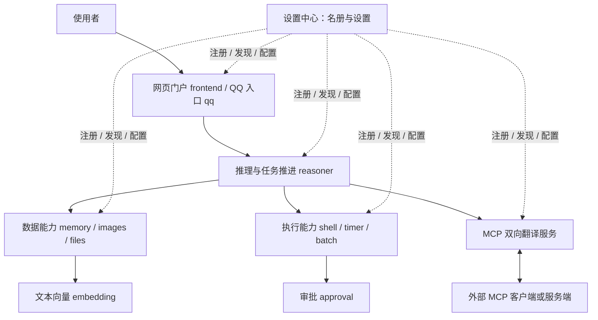

# 01｜从全景认识整个项目：谁负责什么

<!-- attribution:start -->
> 由 **xml-nya-meow** 编写与整理，最初用于个人学习与知识积累。如有疏漏、错误或不清楚之处，欢迎指出。
>
> 本页围绕 [SUMP 主项目](https://github.com/NouSart/sump) 编写，为个人学习资料；项目源码与引用内容保留原作者及贡献者归属。
<!-- attribution:end -->

适用源码：2026-10-29 核对的主线提交 `6325897cc7fa696610bc25b4c89bc77d6a7c7a43`。本章是源码讲解，没有在本次编写中重新运行产品测试。

## 1. 先把 SUMP 想成一组能互相打电话的工作室

你在网页里说：“帮我看看这份资料，稍后提醒我处理。”

屏幕上只有一个对话框，背后却可能有几种不同工作：接收你的话、找到相关记忆、请求模型理解、读取文件、设置计时器、把结果显示出来。

SUMP 把这些工作分到不同的**服务**。服务就是一个运行着、能接收请求并处理特定事务的程序。它有自己的名字、地址和负责范围。

这个比喻有三个对应关系：

| 工作室里的东西 | 程序里的东西 | 为什么需要 |
| --- | --- | --- |
| 名字与电话号码 | 服务名与网络地址 | 知道找谁、去哪里连接 |
| 业务说明 | 动作声明 `provides` | 知道能请它做什么 |
| 申请单与回执 | 协议消息 | 双方按同一套格式交流 |

工作室之间不翻对方的抽屉。对应到代码，就是服务只管理自己的数据库和运行状态；要别人的数据，发请求让对方提供。

这就是“我的下属的下属不是我的下属”在这里的一种具体落点：调用方依赖对方承诺的输入输出，不越过边界接管对方内部实现。MCP 接入的外部工具也不会因此自动成为原生服务，或自动获得向外公开的资格。

## 2. 先分清三种容易混用的“模块”

**源码目录**是文件的分类方式。**Go Module** 是 Go 管理依赖和构建的单元，通常有一份 `go.mod`。**运行服务**是启动后接收请求的进程。三者不是一一对应。

本版 `go.work` 列出 **15 个 Go Module**。其中 `protocol`、`service` 是公共库，`tests`、`approval-integration` 用于验证；其余 11 个是 Go 服务模块。再加 Python 的 embedding 和 TypeScript 的 frontend，开发启动脚本会组织 **13 个服务进程**。

这也解释了为什么不应该直接把“顶层文件夹数”当成“服务数”。

| 类型 | 目录 | 需要单独启动吗 |
| --- | --- | --- |
| 公共通信库 | `protocol`、`service` | 不需要；其他 Go 程序构建时引用 |
| Go 服务 | `settings-center`、`reasoner`、`memory`、`images`、`files`、`qq`、`shell`、`approval`、`timer`、`batch`、`mcp` | 按功能需要启动 |
| 其他语言服务 | `embedding`、`frontend` | 按功能需要启动 |
| 测试工程 | `tests`、`approval-integration` | 测试时运行，不是常驻业务服务 |
| 辅助内容 | `scripts`、`locales`、`third_party`、`.github` | 分别是脚本、语言包、第三方素材和自动检查配置 |

源码依据：[go.work](https://github.com/NouSart/sump/blob/6325897cc7fa696610bc25b4c89bc77d6a7c7a43/go.work)、[开发启动脚本](https://github.com/NouSart/sump/blob/6325897cc7fa696610bc25b4c89bc77d6a7c7a43/scripts/run-local.ps1)。这里数的是这份脚本与工作区，不是在保证你的电脑已经启动了这些进程。

## 3. 分成五层看，会比一口气背目录容易

下面是学习用的分层，不是新增的程序层级。

如果阅读器不能显示图，可以读成：**入口接单，reasoner 推进任务，各能力服务分别处理，结果再返回入口。设置中心帮助大家找到彼此和调整设置。** 图省略了一部分注册连线；approval、embedding 等也有各自注册过程。

这里的箭头表示主要调用关系，不表示每次请求必须把所有节点走一遍。只聊天时未必需要 shell；读取文件时不必经过 timer；外部 MCP 客户端也能直接调用明确导出的工具，不一定经过 reasoner。

## 4. 每个运行模块的职责卡

先认职责，具体字段和实现放在后续课程。

| 模块 | 它是什么、能做什么 | 如何实现、主要与谁关联 | 不要误认为 |
| --- | --- | --- | --- |
| `settings-center` | 通讯录与设置管理服务；注册、名册广播、心跳离线检测、设置下发 | Go；内存名册、JSON 覆盖配置；与服务和门户通信 | 所有业务请求都要经过的代理 |
| `frontend` | 用户门户；聊天、任务/历史展示、设置、人工审批操作 | Node.js 服务节点 + React 页面；浏览器通过 HTTP/SSE，节点通过 SUMP 消息访问服务 | 只有一堆静态网页；或任务真相都由页面决定 |
| `qq` | QQ 私聊入口与回复出口 | Go；连接外部 NapCat，转成 SUMP 消息；关联 reasoner、images、files | QQ 官方服务本体；或已经实现完整群聊能力 |
| `reasoner` | 组织模型输入、派发工具、维护进行中任务上下文、交付回答 | Go；模型 HTTP 客户端、内存黑板、并发工具跟踪；访问记忆与工具服务 | 模型本身；或所有业务代码都写在这里 |
| `memory` | 会话、历史、任务档案、长期记忆、经验网 | Go + SQLite；组装召回上下文，按需访问 embedding | 模型参数；或整个系统共享的一张数据库 |
| `embedding` | 把文本变成用于相似度比较的数字向量 | Python；真实后端使用 ONNX Runtime/tokenizers，fake 后端供测试；主要被 memory 调用 | 能写回答的聊天模型；fake 后端也有真实语义能力 |
| `images` | 保存图片、按编号取回图片内容 | Go；SQLite 元信息 + 文件目录；被入口与 reasoner 等访问 | 自己完成图片识别的视觉模型 |
| `files` | 保存与读取文件，处理部分 Office 内容与编辑 | Go；自有数据库/文件目录；读取器和对应格式编辑实现 | 任意格式都能无损理解与编辑 |
| `shell` | 接受命令执行申请，检查执行边界并运行进程，回报输出 | Go；操作系统进程、输出截断、终止进程树；访问 approval 并向调用方补报 | 收到请求就执行；或当前自带无限排队机制 |
| `approval` | 对执行描述作规则裁决；需要时等待用户批准/拒绝 | Go；PowerShell AST、Bash 规则、执行摘要与许可、门户审批连接 | 面向聊天文本的提示词审查器 |
| `timer` | 延时后回报，允许查询/取消计时 | Go；内存计时任务；向原调用方补报，可通知门户 | 替模型阻塞等待的长睡眠；或持久日程平台 |
| `batch` | 管理一批获准动作的并发执行与状态 | Go + SQLite；批次与条目管理，容量限制、暂停/恢复等；调用声明 `batchable` 的服务 | reasoner 的所有思考都必须交给它调度 |
| `mcp` | SUMP 与外部 MCP 双向协议翻译 | Go + MCP SDK；显式导入/导出、认证、参数结果转换、异步关联 | 模型供应商路由器；或自动公开一切服务的网关 |

详细阅读：[入口与推理](03-入口门户与推理中枢.md)、[数据服务](04-记忆向量与文件数据.md)、[执行及 MCP](05-执行审批计时批处理与MCP.md)。

## 5. 技术栈不是名词清单：每一种技术解决哪件事

| 技术 | 通俗解释 | 在本版里的用途 |
| --- | --- | --- |
| Go | 一种可编译成程序的语言；有并发、网络等标准库 | 大部分服务和公共通信骨架；工作区声明 Go 1.26.0 |
| Python | 另一种编程语言，常用于模型推理生态 | embedding；独立进程实现协议 |
| TypeScript / JavaScript | 浏览器和 Node.js 生态常用语言；TS 增加类型检查 | frontend 服务端、网页逻辑 |
| React | 把页面拆成组件的界面库 | 对话、设置、审批等视图 |
| Vite | 前端开发与打包工具 | 将网页源码构建为浏览器可加载文件 |
| WebSocket | 建立后可双向发消息的连接 | SUMP 原生服务间传输 |
| MessagePack | 把对象编码成紧凑字节的格式 | WebSocket 中的 SUMP 消息编码 |
| HTTP / JSON | 请求响应的通信方式 / 易阅读的数据格式 | 浏览器 API、模型 API、MCP 外部边界等，具体契约各不相同 |
| SSE | 服务器持续向浏览器推送事件的 HTTP 通道 | 门户接收消息、进度、状态更新 |
| SQLite | 嵌在程序中使用、保存在文件里的数据库 | memory、files、images、batch 各自的数据，不跨服务共用表 |
| ONNX Runtime | 执行 ONNX 格式模型的推理引擎 | embedding 的真实文本向量后端 |
| MCP SDK | 实现 MCP 协议的现成开发库 | MCP 客户端/服务端通信；不代替 SUMP 的映射规则 |
| Git / GitHub Actions | 版本记录工具 / 自动检查平台 | 确认读哪版代码、在提交后运行检查 |

版本学习时优先看 `go.mod`、`package-lock.json`、`pyproject.toml` 等依赖文件。`package.json` 的 `^` 表示允许一定版本范围；不能把这个范围当成某台机器实际安装的精确版本。

源码入口：[frontend/package.json](https://github.com/NouSart/sump/blob/6325897cc7fa696610bc25b4c89bc77d6a7c7a43/frontend/package.json)、[embedding/pyproject.toml](https://github.com/NouSart/sump/blob/6325897cc7fa696610bc25b4c89bc77d6a7c7a43/embedding/pyproject.toml)、[mcp/go.mod](https://github.com/NouSart/sump/blob/6325897cc7fa696610bc25b4c89bc77d6a7c7a43/mcp/go.mod)。

## 6. 模块怎样串起来：看四条有不同目的的路线

### 路线 A：启动后互相认识

服务启动 → 监听自己的地址 → 向 settings-center 注册 → 获得名册 → 后续接收名册更新。

这条路线解决“谁在哪里”。它不包含模型回答。

### 路线 B：普通业务

入口收到用户消息 → reasoner 请求记忆 → 记忆送回上下文 → reasoner 请求模型 → 必要时直接访问工具服务 → 收集结果 → 向入口交付。

这条路线解决“用户的事情怎样完成”。模型说要调用工具之后，仍要由程序发请求、由工具真正执行。

### 路线 C：运行中调整设置

网页提交设置 → frontend 请求中心 → 中心受理并下发 `configure` → 目标服务校验/应用 → 中心广播结果 → frontend 更新页面。

这条路线解决“程序以后按什么参数工作”。中心已保存覆盖值，与目标服务已经应用，是两个阶段。

### 路线 D：异步结果回来

调用方请求 timer 或 shell → 先拿到受理句柄 `item_id` → 服务继续工作 → 服务主动发 `report_result` → 调用方按句柄关联原工作。

这条路线解释为什么网页可以先显示“受理了”，稍后才有“完成了”。具体状态由各服务定义，不能看见一个 `ok:true` 就断言整项业务成功。

## 7. 数据放在哪里，谁有权解释它

| 信息 | 负责模块 | 生命周期意味着什么 |
| --- | --- | --- |
| 在线服务名册 | 设置中心；其他服务持有副本 | 是此刻发现服务的线索，不是每个业务都健康的证明 |
| 普通配置覆盖值 | 设置中心 | 保存的是管理意图，应用结果另看服务回报 |
| 秘密配置 | 消费该秘密的服务 | 不通过列表回显；仍需保护本地秘密文件 |
| 会话、历史、任务档案、记忆 | memory | 可持久保存；不等于自动恢复全部在途工作 |
| 当前模型消息链与运行中工具关系 | reasoner 内存黑板 | 属于任务运行窗口；不是持久消息队列 |
| 文件/图片正文与索引 | files / images | 调用方用编号访问；不直接打开另一服务的数据库 |
| 批次与条目记录 | batch | 持久记录用于查询/恢复语义；不自动证明每项外部动作只执行一次 |
| 计时器与 MCP 在途跟踪 | 各自服务的运行状态 | 不应据此承诺重启后恢复全部工作 |
| 页面选中项、展开状态 | 浏览器组件 | 是展示状态，不替代任务所有者的事实 |

**权威数据**的意思是：发生争议时，到负责这份事实的服务核实。例如页面暂时没收到推送，不足以证明任务没有完成。

## 8. 并行发生在哪里

**并发**是多件事在一段时间里交错推进；**并行**是其中一些真的同时执行。Go 的 goroutine 是轻量并发执行单元，不是每个都独占一个 CPU 核心。

SUMP 的几处并发各有目的：

- 服务是不同进程，文件读取可以与计时同时存在。
- 骨架把收到的动作交给各自处理函数，慢动作不会直接占住连接读循环。
- reasoner 可以派发多个工具调用，并按各自编号收集结果。
- batch 管理一批条目的并发、容量与状态。
- shell 控制自己允许同时运行多少命令；MCP 管理自己的外部调用边界。

这些上限不必相同，也不是一个“全局最大并发”开关。工具能并发，不代表同一会话模型一定同时推理多轮；一次模型请求也不会因为 Go 能并发就变成瞬间完成。

## 9. 目前已经有什么，哪些不能顺手许诺

本版有原生门户，有审批的人机交互，有数据与执行服务，也有 MCP 双向翻译。学习时不需要再另造一套 UI 才能解释原项目。

但要保留以下边界：

- 独立进程不是操作系统沙箱，网络可达也不是身份可信。
- 本地运行顺畅，不直接等于已经适合把所有原生端口开放到公网。
- 工具的 JSON 内容、检索结果和文件正文是数据，不因进入系统就变成可信管理指令。
- 模块存在不等于所有组合都做过真实设备验证。
- 本文未把尚未合入这份提交的修订当成当前能力。

## 10. 一个小练习

不用运行程序。试着回答：

1. 设置中心暂时断开后，已经知道对方地址的两个服务是否必然不能交流？
2. 保存图片和理解图片内容，是不是同一件事？
3. `service/` 这个文件夹是否要像 `timer` 一样启动？

参考答案：已有地址的点对点请求仍可能成功，但新注册/配置/名册更新会受影响；images 保存和取回图片，视觉理解通常发生在支持图片的模型调用侧；service 是库，由程序引用，不单独启动。

下一章：[一条消息怎样找到服务](02-消息协议注册发现与配置.md)。

课程导航：[本组课程入口](README.md) · [完整请求流程](06-一次请求的完整旅程.md) · [术语词典](08-术语状态与学习地图.md)。

<!-- attribution-footer:start -->
---

**编写与整理：xml-nya-meow** · 原用途：个人向知识库。

如有不足，欢迎提出勘误或改进建议：[反馈入口](https://github.com/xml-nya-meow/sump-knowledgebase/issues)。

[个人知识库](https://github.com/xml-nya-meow/sump-knowledgebase) · [SUMP 主项目](https://github.com/NouSart/sump)

阅读时请核对本页对应的源码版本；本文不代表 SUMP 官方文档。转载或同步时请保留编写者、来源和适用的许可说明。

内容责任与立场说明：若知识库内容存在问题，由对应编者负责核查与修订；本页内容不代表其他团队成员、组织成员或组织的意见与观点。
<!-- attribution-footer:end -->
