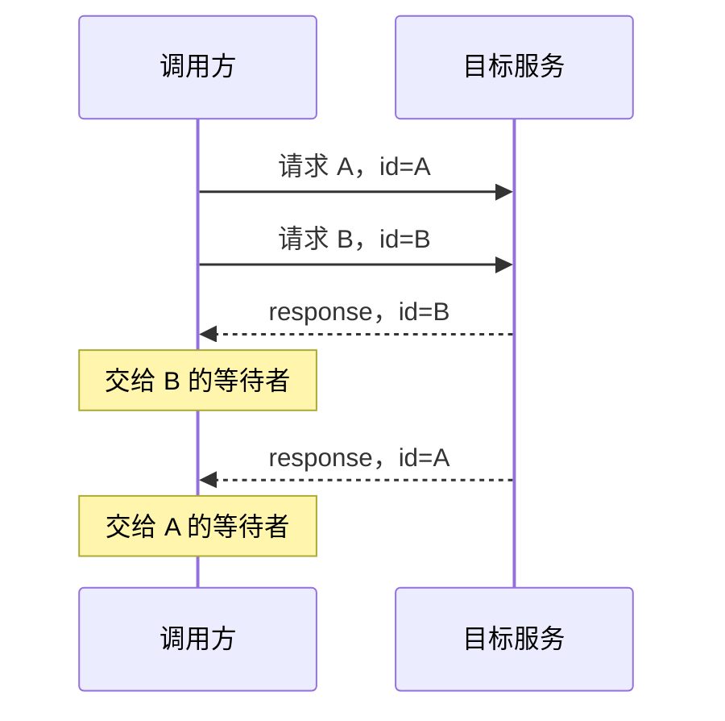
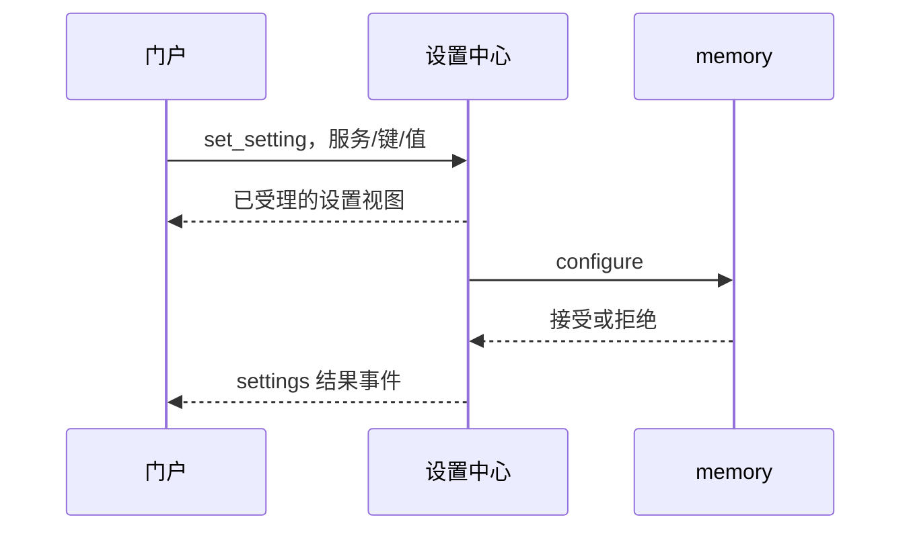

# 02｜消息协议、注册发现与配置：一条消息怎样找到服务

<!-- attribution:start -->
> 由 **xml-nya-meow** 编写与整理，最初用于个人学习与知识积累。如有疏漏、错误或不清楚之处，欢迎指出。
>
> 本页围绕 [SUMP 主项目](https://github.com/NouSart/sump) 编写，为个人学习资料；项目源码与引用内容保留原作者及贡献者归属。
<!-- attribution:end -->

适用源码：`6325897cc7fa696610bc25b4c89bc77d6a7c7a43`。以下示意是教学数据，不是实际用户日志。本次只核对源码与测试定义。

## 1. 先用三个问题理解通信

你要请文件服务读取资料，至少需要知道：

1. **找谁？** 服务名 `files`。
2. **怎么联系？** 名册里的地址，例如本机 `ws://127.0.0.1:9802/ws`。
3. **说什么？** 动作 `read`，以及要读取的文件编号。

服务名类似联系人名字，地址类似电话号码，协议类似双方约定的申请单格式。电话号码正确，不代表申请单内容就合法；申请单格式正确，也不代表接收方一定在线。

## 2. protocol、service、settings-center 各做一层

| 名字 | 它提供的东西 | 举例 |
| --- | --- | --- |
| `protocol` | 消息类型、字段结构、编码解码、请求响应配对 | `Envelope`、`JumpPayload`、`Client.Call` |
| `service` | 可复用的 Go 服务运行骨架 | 开 WS 端点、注册、心跳、分派动作、调用别人 |
| `settings-center` | 真正在运行的名册与设置服务 | 保存服务名片、广播名册、下发设置 |

**库**是一套供别的程序引用的代码。**服务**是启动后能接收请求的程序。所以前两个不是额外占端口的中心服务。

非 Go 程序仍能参与：Python 的 embedding 和 TypeScript 的 frontend 自己实现对应通信，只要线上的字段和编码契约一致。`protocol` 是 Go 实现，不是要求所有服务都用 Go。

源码入口：[protocol/types.go](https://github.com/NouSart/sump/blob/6325897cc7fa696610bc25b4c89bc77d6a7c7a43/protocol/types.go)、[service/service.go](https://github.com/NouSart/sump/blob/6325897cc7fa696610bc25b4c89bc77d6a7c7a43/service/service.go)。

## 3. WebSocket 运货，MessagePack 打包

**WebSocket** 是网络连接方式。连接建立后，双方可以互发消息。

**MessagePack** 是消息的编码方式。它把“字段名、字符串、数字、列表”等变成字节。接收方再还原。

可以把 WebSocket 想成运输线路，把 MessagePack 想成打包规则。运输线路并不知道里面的 `read` 是读文件还是其他业务，业务含义由接收服务决定。

当前原生 SUMP 消息使用 **WebSocket 二进制帧 + MessagePack**。下面用 JSON 画出对象形状方便阅读，不代表可以把 JSON 文本直接塞进原生 WS 当成真实请求。

浏览器到 frontend 的 HTTP/JSON、frontend 到浏览器的 SSE、模型 API、MCP 协议是另外的边界。它们不是全部使用同一份 SUMP 信封。

## 4. 把信封一层层打开

**信封 `Envelope`** 是外壳，先交代来源、目的地和消息类型；`payload` 是里面的正文。

```json
{
  "v": 1,
  "id": "request-example-1",
  "trace": "trace-example-1",
  "boss": "frontend",
  "type": "jump",
  "from": "reasoner",
  "to": "files",
  "payload": {
    "action": "read",
    "input": {"id": "file-example-1"}
  }
}
```

这是**解码后的教学示意**；编号为占位符，文件编号必须在 files 中实际存在才读得到。

| 字段 | 通俗解释 | 不要误解为 |
| --- | --- | --- |
| `v` | 信封协议版本，本版常量为 1 | SUMP 产品发布版本 |
| `id` | 这次消息请求的编号 | 永远不变的任务编号 |
| `trace` | 沿相关调用链传递的追踪编号 | 自动带全部调用历史的日志 |
| `boss` | 本跳为谁工作、最终交付方向的线索 | 全局管理员身份或授权凭据 |
| `type` | 消息大类，如 `jump`、`response` | 具体业务动作 |
| `from`、`to` | 声称的来源服务、目标服务 | 自动认证过的真实身份 |
| `payload.action` | 具体请求做什么 | 任意 Go 函数名都能调用 |
| `payload.input` | 这个动作需要的参数 | 所有动作统一的一份字段表 |

`boss` 是逐跳传入的，不要求永远沿用最上游。`NewEnvelope` 不会自动替你填写 boss；`service.Call` 用调用者提供的值填写。`NewResponse` 则沿用请求的 `id`、`trace`，把回复目标设成原 `from`，并没有复制整份原信封。

为什么强调这一点？因为“字段有某种用途”不等于“每条程序路径都会自动传完整”。看真实路径时仍要核对调用参数。

源码依据：[Envelope / NewEnvelope / NewResponse](https://github.com/NouSart/sump/blob/6325897cc7fa696610bc25b4c89bc77d6a7c7a43/protocol/envelope.go)、[JumpPayload / ResponsePayload](https://github.com/NouSart/sump/blob/6325897cc7fa696610bc25b4c89bc77d6a7c7a43/protocol/payloads.go)。

## 5. 回应怎样找到原请求

假设先发文件请求 A，再发请求 B。B 先完成，不应该因为它先回来就交给 A。

`protocol.Client` 使用一个 `pending` 表：**请求 id → 等待这份回复的通道**。

**通道 channel** 是 Go 里传递值或通知的工具，可以先理解成某一次请求专用的收件格。

1. `Call` 先给本次 id 建立收件格。
2. 发送编码后的请求。
3. 读循环收到 `type=response`，按 id 找到收件格。
4. 等待者拿到对应的回复，或因超时/断线结束等待。
5. 请求结束后删除表项。



乱序是正常现象。正确性来自编号关联，不来自“第几个返回”。连接写操作还使用互斥锁，避免多个 goroutine 同时往同一条连接写出相互冲突的数据。

源码依据：[Client.Call / readLoop / Send](https://github.com/NouSart/sump/blob/6325897cc7fa696610bc25b4c89bc77d6a7c7a43/protocol/client.go)。

## 6. 服务怎样加入网络

服务启动时拥有三项引导信息：自己的名字、自己的监听地址、设置中心地址。

**监听**是把一个地址和端口打开，等别人来连接。**端口**可以理解成一台电脑上某个程序的接待窗口。

以 Go 骨架为例：

| 顺序 | 发生的事 | 此时能确定什么 |
| --- | --- | --- |
| 1 | `service.New` 建实例，登记动作/设置 | 代码对象准备好，还没上线 |
| 2 | `Start` 加载自己的秘密项，建立 WS 监听 | 有了接待地址，但还没完成注册 |
| 3 | `connectAndRegister` 向中心发 `register` | 等中心认可这份服务名片 |
| 4 | 注册响应带回完整 `roster` | 服务获得当前通讯录 |
| 5 | 保存名册，启动心跳/设置兜底拉取/中心连接监视 | 进入运行维护阶段 |

首次注册失败时，骨架会关闭监听并让启动返回错误，不把“只开了一个端口”假装成完成接入。

服务的注册名片包含 `name`、`addr`、`provides`、`settings`、`heartbeat_ms` 等。对其他服务广播的 `ServiceCard` 去掉 `settings`；想查看设置，使用中心的设置查询动作。

**名册 roster** 是服务列表，**revision** 是名册变动版本号。中心 `Register` 在名片没有变化时只更新连接/心跳，不为同样内容重复推进版本并广播。

源码依据：[connectAndRegister](https://github.com/NouSart/sump/blob/6325897cc7fa696610bc25b4c89bc77d6a7c7a43/service/service.go)、[Hub.Register / Snapshot](https://github.com/NouSart/sump/blob/6325897cc7fa696610bc25b4c89bc77d6a7c7a43/settings-center/hub/hub.go)。

## 7. 心跳与重连分别解决什么

**心跳**是定期报告“我还活着”。Go 骨架未指定间隔时使用 15 秒，并在名片声明间隔。中心扫描时，超过声明间隔的两倍仍未收到心跳，会摘除名片；实际判定还受扫描时机影响，不是保证某个毫秒点准时下线。

正常退出可发送 `status=bye`，让中心立即处理下线。意外断开时，中心不是仅凭一次连接断开就立即断言服务消失，而是结合心跳超时。

**重连**解决“连接丢了，再建立连接”。骨架发现中心连接断开后等待并重试，失败时逐步增加间隔，上限 30 秒；重新注册后获得新的名册。

这不等于自动重启崩溃的程序，也不等于恢复它丢失的内存任务。进程重启、数据恢复、连接重建是三件不同的事。

如果中心暂时不可达，两个已知地址的服务仍可能直连成功；但新增发现、配置管理和名册新鲜度会受影响。不能把“中心不转发业务流量”理解成“中心永远不重要”。

## 8. 真正处理动作的路径

在服务中，`Handle("read", handler)` 一类调用把动作名连到处理函数。处理函数就是接到某类申请后具体干活的代码。

```text
WS 收到二进制消息
→ Unmarshal 还原信封
→ 检查 type 是否为 jump
→ DecodePayload 读 action 与 input
→ 按 action 找已登记的 handler
→ handler 校验参数、执行业务
→ 编码数据，返回 response
```

Go 骨架的 `serveConn` 为动作启动 goroutine，`handleJump` 给处理函数提供带超时的 `Context`。**Context** 携带取消/截止时间信号；业务代码需要主动响应它，设置一个超时对象不等于强制杀死任意代码或进程。

未知动作返回错误；已知动作也可能因输入不合法或业务失败而返回 `ok:false`。`ok:true` 的含义由动作契约决定：有的表示最终读取成功，有的只表示异步受理成功。

## 9. Call、Fire 与补报不是同一件事

| 方式 | 当前实现做什么 | 调用方知道什么 |
| --- | --- | --- |
| `protocol.Client.Send` | 写出一条信封，不等响应 | 写出是否返回错误 |
| `service.Call` | 解析目标、建立短连接、发请求、等 response | 这一次请求的响应或错误 |
| `service.Fire` | 在后台 goroutine 中执行 `Call` | 当前函数立即返回；后台完成情况记日志/上报 |
| `report_result` | 某个已受理工作稍后发起的独立动作请求 | 由 `item_id` 等关系配回先前工作 |

`Fire` 不是脱离网络协议随便发一句；它在后台仍会调用 `Call`。它也不是持久消息队列，不能保证失败后永远重投。

`service.Call` 的业务跳转当前每次建立短连接，用完关闭。中心注册连接则用于心跳与事件。因此不要把“使用 WebSocket”直接推成“所有服务互相永久连着”，也不要把旧规划中的自适应保活当成本版已实现。

## 10. 超时后为什么不能随便再来一次

场景一：连接根本没建立。当前骨架只对这类拨号失败进行有限重试，等待约 0.5 秒、2 秒后再尝试；总过程仍受调用者的 Context 约束。

场景二：请求已发出，等响应时断线。对方可能还没做，也可能做完但回复丢了。骨架不会对这类业务调用自动重放。

**幂等**指同一操作重复请求，不会多产生一份业务效果。例如“把值设为 3”常有幂等设计空间，“再发一条消息”通常不能直接假定幂等。

因此“没有拿到结果”不等于“没有执行”。要安全重试，需要业务设计查询、去重编号或明确的幂等契约，不能单靠网络超时猜测。

设置中心的配置下发是另一条专门路径，具有自己的有限重试策略，不能把它套到任意工具执行上。

## 11. 设置修改的一生：两张成绩单

假设在门户把 memory 的 `recall.history_limit` 改成一个新数字。这是教学流程，实际允许范围看目标服务的校验代码。



| 阶段 | 状态含义 | 能不能说已生效 |
| --- | --- | --- |
| 提交之前 | 页面里只是输入了新值 | 不能 |
| 中心受理普通设置 | 中心保存覆盖值，准备异步下发 | 不能仅凭此判断 |
| 服务校验通过并应用 | 服务按新值运行，回报成功 | 可在该范围内确认 |
| 服务明确拒绝 | 中心意图与服务现状可能不同 | 应展示原因，不能冒充成功 |
| 传输未确认 | 未拿到有效应用响应 | 无法确定已应用，应核查状态 |

两张成绩单分别是“管理端提交什么”和“服务端实际怎样”。`report_setting` 是服务报告自己的事实，不会自动替换中心的覆盖值。

普通项、秘密项、只读项还要分开：

| 类别 | 谁保存 | 怎样修改 | 面板看到什么 |
| --- | --- | --- | --- |
| 普通项 | 中心保存覆盖值 | 下发到消费服务校验/应用 | 值、默认值、覆盖/送达状态 |
| 秘密项 | 消费服务自己持久化 | 中心仅在提交时转发；重置让服务清空 | 是否设置，不回显原秘密 |
| 只读项 | 启动配置所确定 | 运行时修改会被拒绝 | 当前启动值 |

“秘密不在中心保存”不等于“秘密从未经过中心内存或网络”。其本地文件也不是加密保险箱。本版骨架会处理应用与保存失败的回滚，但不能由此声称所有回调副作用都可撤销；必须检查具体服务实现。

源码依据：[settings-center 下发实现](https://github.com/NouSart/sump/blob/6325897cc7fa696610bc25b4c89bc77d6a7c7a43/settings-center/server/server.go)、[service 设置处理](https://github.com/NouSart/sump/blob/6325897cc7fa696610bc25b4c89bc77d6a7c7a43/service/settings.go)、[秘密文件保存](https://github.com/NouSart/sump/blob/6325897cc7fa696610bc25b4c89bc77d6a7c7a43/service/secrets.go)。

## 12. 三个开关管三件不同的事

名片的 `provides` 描述动作，它包含三个不能互相替代的布尔标记：

- `tool:true`：动作愿意向模型暴露为工具；reasoner 还会筛除保留/调试动作。
- `async:true`：这个动作先受理，结果以后补报。
- `batchable:true`：动作愿意被 batch 批量调用。

未声明不能直接当作开启。动作可被原生服务调用，不自动等于模型可调用；模型可调用，也不自动等于批量可调用；这三项更不等于已经允许通过 MCP 对外导出。

`provides.input/output` 是给人和模型看的描述字符串，不是通用严格 JSON Schema。字段合法性最终仍要看处理函数；MCP 的显式 Schema 是另一个协议边界的工作。

## 13. 读懂错误的练习

1. 网页显示服务在线，但 `read` 返回未知文件。是哪层问题？
2. 中心显示设置已覆盖，服务返回参数超范围。新值真的生效了吗？
3. 一个 `report_result` 晚于原始 `response` 到来，是不是异常？

答案：第一项是业务查找问题，不是在线发现本身；第二项没有因“已覆盖”而生效，应看服务拒绝原因；第三项通常正是异步设计，关键是句柄归属和终态是否正确。

下一章：[入口门户与推理中枢](03-入口门户与推理中枢.md)。

课程导航：[本组课程入口](README.md) · [完整请求流程](06-一次请求的完整旅程.md) · [术语词典](08-术语状态与学习地图.md)。

<!-- attribution-footer:start -->
---

**编写与整理：xml-nya-meow** · 原用途：个人向知识库。

如有不足，欢迎提出勘误或改进建议：[反馈入口](https://github.com/xml-nya-meow/sump-knowledgebase/issues)。

[个人知识库](https://github.com/xml-nya-meow/sump-knowledgebase) · [SUMP 主项目](https://github.com/NouSart/sump)

阅读时请核对本页对应的源码版本；本文不代表 SUMP 官方文档。转载或同步时请保留编写者、来源和适用的许可说明。

内容责任与立场说明：若知识库内容存在问题，由对应编者负责核查与修订；本页内容不代表其他团队成员、组织成员或组织的意见与观点。
<!-- attribution-footer:end -->
