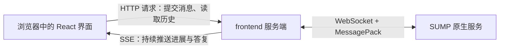

# 03｜入口门户与推理中枢：一句话怎样变成可执行的工作

<!-- attribution:start -->
> 由 **xml-nya-meow** 编写与整理，最初用于个人学习与知识积累。如有疏漏、错误或不清楚之处，欢迎指出。
>
> 本页围绕 [SUMP 主项目](https://github.com/NouSart/sump) 编写，为个人学习资料；项目源码与引用内容保留原作者及贡献者归属。
<!-- attribution:end -->

本篇对应主线提交 `6325897cc7fa696610bc25b4c89bc77d6a7c7a43`，阅读日期为 2026-10-29。这里分析的是这份源码，不把后续分支上的修改当作已经合入。

本文核对源码与已有测试的写法，没有执行这些测试。例子是教学模拟，不是实际运行记录。

## 1. 先认清三位参与者

你在网页里写“帮我读一下这个文件”，这句话不会直接进入操作系统。

它先经过一个**入口服务**，再交给 **reasoner**，必要时才去调用 **files** 这样的工具服务。

可以把它想成一间工作室：

- `frontend` 是网页接待窗口，收消息、显示进展、展示结果。
- `qq` 是另一扇接待窗口，收 QQ 私聊，再把结果发回 QQ。
- `reasoner` 是工作组织者，整理上下文、调用模型、派发工具、接收结果。

这里的“大脑”并不是单独一个程序。模型负责生成下一步建议；reasoner 负责把建议变成受约束的程序行为；工具服务负责真正干活。

| 模块 | 它自己负责什么 | 它依赖谁提供什么 | 它不拥有的东西 |
|---|---|---|---|
| frontend | 网页、HTTP 接口、实时展示、用户裁决的转交 | 设置中心给名册；reasoner 给答复；memory 给历史；approval 给待审项 | 命令的执行权、任务的完成判定 |
| qq | NapCat 连接、授权私聊过滤、附件入库、回发文字 | reasoner 处理任务；images/files 存附件 | 模型推理循环、附件服务的数据库 |
| reasoner | 模型调用、工具派发、任务黑板、补报关联、交付 | memory 给上下文；模型给生成结果；工具服务给实际业务结果 | 其他服务内部实现、所有服务的持久任务状态 |

**依赖**在这里是“发消息，请对方做事”。不是把对方的数据库直接打开，也不是把对方整个程序装进自己进程。

## 2. frontend 为什么既是网页，又是服务

`frontend` 包含两个运行位置不同的部分。

### 2.1 浏览器里的界面

浏览器负责把文字、按钮、任务目录和时间线画出来。

| 技术 | 通俗解释 | 在本模块中做什么 |
|---|---|---|
| TypeScript | 给 JavaScript 加上类型检查的语言 | 提前发现“这里应该是数字，却传了文字”等问题 |
| React | 按组件组织界面的工具 | 组织聊天区、设置区、待审批条等组件 |
| Vite | 前端构建工具 | 把开发时的源码整理成浏览器可以加载的资源 |
| CSS | 控制外观的规则 | 控制布局、颜色、字体和动画 |
| Markdown 渲染 | 把带标记的文字排版 | 将回答中的代码块、表格、列表展示出来 |

**组件**可以理解为一块有独立职责的界面，例如设置面板。组件不是独立服务；它通常运行在同一个网页中。

对应源码：[package.json](https://github.com/NouSart/sump/blob/6325897cc7fa696610bc25b4c89bc77d6a7c7a43/frontend/package.json)、[PortalView.tsx](https://github.com/NouSart/sump/blob/6325897cc7fa696610bc25b4c89bc77d6a7c7a43/frontend/src/web/components/PortalView.tsx)。

### 2.2 Node.js 里的服务端

**Node.js** 是在浏览器外运行 JavaScript/TypeScript 编译结果的运行环境。

frontend 的服务端同时面对两个世界：



图中的 **SSE** 是“服务器发送事件”。浏览器开一条接收通道，服务端以后有消息就推过来；它不是模型接口，也不是 SUMP 内部协议。

**HTTP JSON** 是浏览器常用的请求形式。用户点按钮，浏览器发送请求；服务端返回 JSON 数据。

**WebSocket + MessagePack** 是 frontend 作为 SUMP 服务节点时使用的通信方式。它会注册、心跳、接收名册，也会接收 `deliver` 等动作。

对应源码：

- [app.ts](https://github.com/NouSart/sump/blob/6325897cc7fa696610bc25b4c89bc77d6a7c7a43/frontend/src/server/app.ts)：组装服务。
- [api.ts](https://github.com/NouSart/sump/blob/6325897cc7fa696610bc25b4c89bc77d6a7c7a43/frontend/src/server/api.ts)：浏览器 HTTP 接口和 SSE。
- [service.ts](https://github.com/NouSart/sump/blob/6325897cc7fa696610bc25b4c89bc77d6a7c7a43/frontend/src/server/service.ts)：接收 SUMP 动作。
- [center.ts](https://github.com/NouSart/sump/blob/6325897cc7fa696610bc25b4c89bc77d6a7c7a43/frontend/src/server/center.ts)：名册、中心连接与向其他服务发请求。

### 2.3 一个容易误读的名字：CenterLink

frontend 的 `CenterLink` 管中心连接，也提供 `jumpTo` 方法。

“方法属于 CenterLink”不意味着“业务经过设置中心转发”。

`jumpTo` 的实际流程是：

1. 在已经收到的名册里找服务名。
2. 取出目标服务的 WebSocket 地址。
3. 用 `dialOnce` 直接连目标服务。
4. 等匹配请求编号的响应。

例如读取历史时，是 frontend 直连 memory。中心提供的是地址簿。

### 2.4 这几个 HTTP 接口各自表示什么

| 浏览器请求 | 服务端实际请求 | 返回内容表示什么 |
|---|---|---|
| `POST /api/message` | reasoner 的 `user_message` | 消息已经受理，不是最终回答 |
| `GET /api/history` | memory 的 `history` | 已记录的历史 |
| `GET /api/tasks` | memory 的 `task_list` | 任务档案列表 |
| `POST /api/tasks/resume` | memory 的 `task_resume` | 切换到可恢复的任务；不等于立即调用模型 |
| `GET /api/events` | 建立 SSE 订阅 | 后续接收事件 |
| `POST /api/approvals` | approval 的 `approval_decide` | 把用户的允许或拒绝送交审批服务 |

本版本网页会话编号固定为 `web:private:owner`。界面能显示多个任务，不代表已经有多个独立网页会话。

本版本也没有完整的网页本地文件上传入口。不要把“项目有 files 服务”推导成“每个入口都已支持上传”。

## 3. 界面里看到的过程从哪里来

门户的对话时间线不是自己推算“模型现在应该做到哪了”。

reasoner 生成三类过程记录：

| `kind` | 展示意义 | 需要注意 |
|---|---|---|
| `reasoning` | 模型接口返回的思考字段 | 取决于模型是否返回；不能当成模型内部全部运算的完整记录 |
| `tool_call` | 将要派发的工具名和参数 | 有这条记录不证明目标已经执行 |
| `tool_result` | 工具结果或最终补报的记录 | 要结合错误、截断与终态字段判断 |

reasoner 的 `record` 尝试把记录发给 memory；如果入口服务声明了 `progress`，还会发一份给入口实时展示。

**两份消息都用异步 Fire 发出。** 代码先调用记录函数，不等于已经确认数据库写入成功再执行工具。网络发送的成功与否仍需要区分。

浏览器刷新后，可以从 memory 读取已有历史。SSE 用来及时显示变化，memory 用来保存已成功写入的记录；SSE 本身不是持久消息队列。

对应源码：[trace.go](https://github.com/NouSart/sump/blob/6325897cc7fa696610bc25b4c89bc77d6a7c7a43/reasoner/server/trace.go)、[portal.ts](https://github.com/NouSart/sump/blob/6325897cc7fa696610bc25b4c89bc77d6a7c7a43/frontend/src/server/portal.ts)。

## 4. QQ 入口：换了接待窗口，后面的主链仍相似

QQ 本身不会直接讲 SUMP 协议。

本版本通过 **NapCat / OneBot 11** 对接 QQ。可把 NapCat 理解为 QQ 与程序之间的桥，OneBot 11 是它们交换事件和动作的一套约定。

```text
QQ 私聊
  → NapCat 产生消息事件
  → qq 服务检查消息类型和发送人
  → 必要时调用 images.save / files.save
  → qq 服务调用 reasoner.user_message
  → 后续 reasoner 调用 qq.deliver
  → qq 服务请求 NapCat 发送私聊文字
```

入口会过滤：

- 非私聊消息，本版本忽略。
- 非配置的 owner 发来的私聊，拒绝处理。
- owner 为空，拒绝所有私聊。

成功存下的图片以图片 ID 随消息传递。文件以文件 ID 和类似“文件名、编号”的占位文字上链；模型之后可以调用文件工具读取。

这也是“数据服务自治”的例子：qq 不直接操作 images 或 files 的数据库，它只调用服务动作。

保存附件失败时，qq 会记录失败并保留简化的附件占位，不会凭空产生一个有效文件 ID。reasoner 不可达时，入口尝试向用户回发“服务暂时不可用”。

对应源码：[qq/server/server.go](https://github.com/NouSart/sump/blob/6325897cc7fa696610bc25b4c89bc77d6a7c7a43/qq/server/server.go)。

## 5. reasoner 里到底有什么

reasoner 主要用 Go 编写，复用 `service` 骨架和 `protocol` 协议。

它在模型服务与 SUMP 工具服务之间承担业务组织职责。

| 源码部分 | 职责 | 类比 |
|---|---|---|
| `server.go` | 创建服务、声明动作、管理设置和模型客户端 | 工作室的接线和开关 |
| `infer.go` | 接受用户输入、记忆往返、构造工具目录、工具参数转换 | 任务接收台与工具清单 |
| `board.go` | 保存本轮工作上下文、派发工具、检查能否收尾 | 正在使用的白板 |
| `async.go` | 关联受理回执和稍后补报 | 每件后台工作的收据夹 |
| `task.go` | 处理模型的任务完成判定 | 给任务档案写结论 |
| `hold.go` | 处理用户停手状态与恢复条件 | 暂停继续派活的控制开关 |
| `trace.go` | 发送过程记录 | 工作记录员 |
| `reflect.go`、`transcript.go` | 交付后的经验提炼和材料整理 | 事后复盘 |
| `think.go` | 给其他服务提供一次不带工具的模型补全 | 单次咨询窗口 |

这些文件大部分在同一个 reasoner 进程中。一个文件不等于一个独立服务。

### 5.1 输入、输出和后台动作

| 动作 | 谁通常调用 | 输入含义 | 返回之后还会发生什么 |
|---|---|---|---|
| `user_message` | frontend、qq | 用户文字、会话编号等 | 后台请求 memory 组装上下文 |
| `resume` | 配置的 memory 服务 | 已组装的上下文、原始交付方、任务档案 | 创建工作黑板，推进模型轮次 |
| `report_result` | 受理过异步工作的工具服务 | 工作编号、阶段、文字、是否终态 | 按原调用归属注入或补充交付 |
| `user_hold` | 控制调用方 | 会话、停手档位、已暂停项和附注 | 暂停新轮次或新派发，按规则恢复 |
| `think` | 需要单次生成的服务 | prompt、可选 system/model 等 | 一次生成后直接返回 text，不开任务 |
| `step` | reasoner 自己 | 会话编号 | 找黑板，尝试继续下一轮 |

`resume` 会比较信封 `from` 与配置的 memory 服务名。这是协议层来源检查，不是密码学身份验证；原生服务网络仍有自己的信任边界。

`think` 虽然是“单次模型调用入口”，不能写成“所有模型调用都一定经过 think 动作”。本版本任务轮次和复盘代码也直接使用 reasoner 自己的模型客户端。它们仍在同一个服务的职责范围内。

对应源码：[infer.go](https://github.com/NouSart/sump/blob/6325897cc7fa696610bc25b4c89bc77d6a7c7a43/reasoner/server/infer.go)、[think.go](https://github.com/NouSart/sump/blob/6325897cc7fa696610bc25b4c89bc77d6a7c7a43/reasoner/server/think.go)。

## 6. 工具目录怎样接起来

服务通过 `provides` 声明动作。如果动作明确标记 `tool: true`，且不属于被屏蔽的结构性动作，reasoner 才把它放进给模型看的工具清单。

例如：

```text
服务名：files
动作名：read
模型看到的名字：files__read
```

模型给出 `files__read` 和 JSON 参数后，reasoner 会：

1. 拆开服务名和动作名。
2. 再检查当前名册里这个动作是否确实允许给模型调用。
3. 把 JSON 参数转换为 MessagePack 输入。
4. 向 files 服务发送请求。
5. 将返回数据转换成模型可以阅读的文字。

这里的工具参数描述主要来自服务声明；不能把当前的通用对象参数声明误说成每个工具都有完备的强类型 Schema 校验。业务服务仍须检查实际输入。

模型能“建议读文件”，files 才能“真的读文件”；模型建议本身没有绕过服务侧规则的能力。

## 7. 并发发生在哪，串行又发生在哪

**并发**是几项工作可以交错推进；并不是每一段代码都要同时运行。

reasoner 的 `dispatchToolCalls` 可以启动多个后台工具工作。每个调用拿自己的编号，结果回来后分别入账。

同一个当前黑板的模型轮次，用 `running` 防止重复开启。同一会话新上下文到来时，`boardOpen` 会替换旧黑板；旧工具的普通结果不会随意写入新黑板。

| 内容 | 保存在哪里 | 有什么用途 |
|---|---|---|
| `messages` | 黑板内存 | 当前模型上下文 |
| `pending` | 黑板内存 | 还没返回普通调用结果的工具 |
| `gen` / `seen` | 黑板内存 | 判断模型是否已经看过最新进展 |
| `running` / `closed` | 黑板内存 | 判断是否正在推进、是否已经结束 |
| `asyncJobs` | reasoner 内存 | 已拿到句柄、等待后续补报的工作 |
| 会话历史和任务档案 | memory 自己的存储 | 历史回填、任务列表、下次上下文组装 |

**水位**可以理解为“记录本更新到了第几版”。如果模型读的是第 5 版，工具结果把黑板更新到第 6 版，就不能把尚未看见新结果的结论直接当作最终答复。

这里的内存状态不跨 reasoner 重启自动恢复。memory 中有历史，不代表所有在途网络调用和后台句柄都自动恢复。

对应源码：[board.go](https://github.com/NouSart/sump/blob/6325897cc7fa696610bc25b4c89bc77d6a7c7a43/reasoner/server/board.go)、[async.go](https://github.com/NouSart/sump/blob/6325897cc7fa696610bc25b4c89bc77d6a7c7a43/reasoner/server/async.go)。

## 8. “暂停”“完成”“回答了”不是同一件事

`user_hold` 控制 reasoner 是否继续开模型轮次、是否派发新的工具。已经在外部运行的命令，不会因为黑板挂起就自动被操作系统杀掉；实际取消要走执行服务自己的控制动作。

`task_status` 是模型使用的内置工具，判定是 `done` 或 `continue`。它能发消息让 memory 更新任务档案。这个更新是异步发送，不是跨服务事务。

**事务**是“一组变化全部成功或全部不算”的机制。这里并没有一个事务把“模型判定、memory 落盘、网页收到答复”绑成不可分割的一步。

因此，下列状态要分别看：

- 收到文字答复：说明交付链走到了入口。
- 任务档案完成：说明 memory 的任务状态已更新。
- 异步工作完成：需要对应工具的最终补报。
- 用户暂停：说明继续推进受到控制，不代表工作从未执行。

更多完整时序见 [一次请求的完整旅程](06-一次请求的完整旅程.md)。

## 9. 看源码时可以做的三个小练习

这些练习不要求启动服务，也不会运行命令。

1. 打开 `frontend/src/server/api.ts`，找到 `sendUserMessage`。确认它返回的是 `ok` 和 `conversationId`，而不是模型的最终回答。
2. 打开 `reasoner/server/infer.go`，找到 `rosterTools` 和 `toolAdvertised`。理解“显示工具目录”和“实际执行前检查”是两个位置。
3. 打开 `reasoner/server/board.go`，找到 `waitPending`。注意它明确披露尚未回报的异步工作，不把收据当成执行结果。

阅读已有测试时可以从这些入口开始：

- [frontend/tests/api.test.ts](https://github.com/NouSart/sump/blob/6325897cc7fa696610bc25b4c89bc77d6a7c7a43/frontend/tests/api.test.ts)：HTTP 受理、历史直连、SSE 与待审批。
- [reasoner/tests/chain_test.go](https://github.com/NouSart/sump/blob/6325897cc7fa696610bc25b4c89bc77d6a7c7a43/reasoner/tests/chain_test.go)：工具调用链和未声明工具的拒绝。
- [reasoner/tests/task_test.go](https://github.com/NouSart/sump/blob/6325897cc7fa696610bc25b4c89bc77d6a7c7a43/reasoner/tests/task_test.go)：任务判定与交付。
- [qq/tests/service_test.go](https://github.com/NouSart/sump/blob/6325897cc7fa696610bc25b4c89bc77d6a7c7a43/qq/tests/service_test.go)：QQ 服务动作与接入行为。

看到测试文件存在，只能说明仓库写了这些验证场景。本篇未执行它们，也不据此宣称所有环境均已通过。

课程导航：[本组课程入口](README.md) · [完整请求流程](06-一次请求的完整旅程.md) · [术语词典](08-术语状态与学习地图.md)。

<!-- attribution-footer:start -->
---

**编写与整理：xml-nya-meow** · 原用途：个人向知识库。

如有不足，欢迎提出勘误或改进建议：[反馈入口](https://github.com/xml-nya-meow/sump-knowledgebase/issues)。

[个人知识库](https://github.com/xml-nya-meow/sump-knowledgebase) · [SUMP 主项目](https://github.com/NouSart/sump)

阅读时请核对本页对应的源码版本；本文不代表 SUMP 官方文档。转载或同步时请保留编写者、来源和适用的许可说明。

内容责任与立场说明：若知识库内容存在问题，由对应编者负责核查与修订；本页内容不代表其他团队成员、组织成员或组织的意见与观点。
<!-- attribution-footer:end -->
