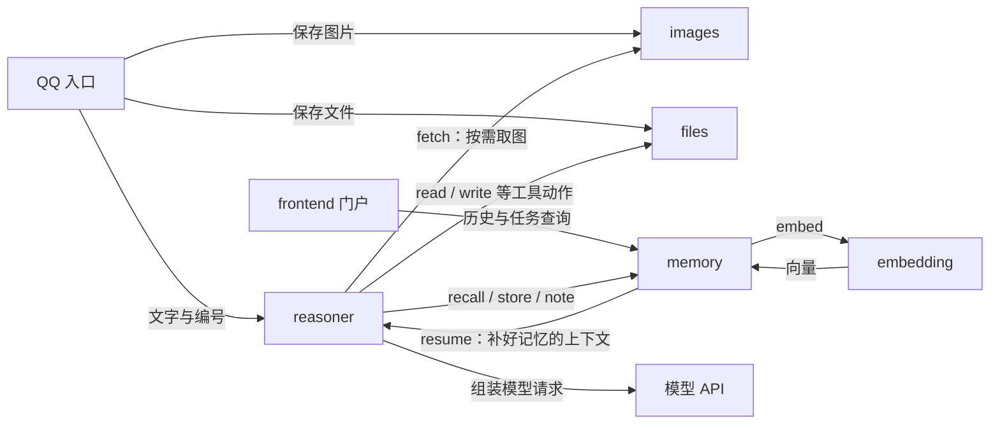

# 04｜记忆、向量与文件：信息放在哪里，又怎样交给模型

<!-- attribution:start -->
> 由 **xml-nya-meow** 编写与整理，最初用于个人学习与知识积累。如有疏漏、错误或不清楚之处，欢迎指出。
>
> 本页围绕 [SUMP 主项目](https://github.com/NouSart/sump) 编写，为个人学习资料；项目源码与引用内容保留原作者及贡献者归属。
<!-- attribution:end -->

本篇对应 **2026-10-29 核查的主线提交 `6325897cc7fa696610bc25b4c89bc77d6a7c7a43`**。下面的动作、字段和限制均以这一份源码为依据。例子是教学模拟；本次编写阅读了实现和测试，未执行这些测试。

## 1. 先把四种工作分开

假设你对助手说：“参考我之前的偏好，看看这张图片，再总结这份表格。”这句话会涉及多种信息，但不需要一个服务包办。

| 服务 | 用一句话解释 | 实际保存什么 | 主要依赖谁 |
|---|---|---|---|
| `memory` | 管理对话、任务、长期记忆和经验 | SQLite 中的文字、任务记录、向量及关系 | `embedding` 帮它计算向量 |
| `embedding` | 把文字转换成可比较的一串数字 | 运行时加载模型；不保存用户的记忆档案 | 本地模型文件和推理库 |
| `files` | 保存文件，按需读取或修改支持的文档 | SQLite 元数据 + 磁盘文件本体 | 自己的存储层和文档处理代码 |
| `images` | 保存图片，按编号取回 | SQLite 元数据 + 磁盘图片本体 | 自己的存储层 |

**SQLite** 是嵌入程序内部的数据库引擎。它通常把数据保存在一个文件里，不要求另外启动数据库服务器。**元数据**是描述数据的数据，例如文件名、大小、类型、实际保存位置；它不等于文件正文。

这四个服务独立运行。`memory` 内部的会话库、长期记忆库和经验网共享同一个数据库句柄，是同一服务内部的安排；`files` 或 `reasoner` 不应直接打开这个库。



图中的箭头是业务关系。SUMP 服务之间通过内部协议通信，不是这些 Go 包互相调用私有函数。`embedding` 虽然用 Python 写，也能按同样的 WebSocket 与 MessagePack 约定参与。

## 2. memory 不是一个“无限长聊天记录”

`memory` 内部至少有四组不同用途的数据。

| 数据 | 表或代码位置 | 白话含义 | 典型用途 |
|---|---|---|---|
| 会话目录 | `conversations` | 一段对话的封面 | 门户列出会话、显示标题与入口 |
| 任务档案与消息 | `tasks`、`messages` | 这次做什么，以及过程中发生什么 | 展示历史、给当前任务补上下文 |
| 长期记忆条目 | `memories` | 明确记下的偏好、身份、知识等 | 以后相关时再提取 |
| 经验网 | `mem_nodes`、`mem_entries`、`mem_links` | 从做事经历中留下的经验及关联 | 找出类似经历，再顺着线索展开 |

“会话”比“任务”更大。同一个会话里可以先整理表格，再讨论下一件事。当前任务表的主要状态是 `active` 和 `done`，分别表示进行中、已完结；不能把 shell 的运行状态、batch 的暂停状态直接塞进这两个词里理解。

当前源码通过 **部分唯一索引** 保证：同一个会话最多有一个 `active` 任务。索引是数据库帮助查找或约束数据的结构；“部分”表示只对满足条件的行应用约束。

下面是源码中的关键约束：

```sql
CREATE UNIQUE INDEX IF NOT EXISTS idx_tasks_one_active
ON tasks(conversation_id) WHERE status = 'active'
```

它限制的是“任务档案”，并不限制一个任务只能调用一个工具。一个任务仍可以有多个并行工具工作。

任务是否做完由 `reasoner` 判断，`memory` 的 `task_finish` 负责记录结果。`task_resume` 只恢复仍为 `active` 的任务；已完成任务可以查看，不会通过这个动作重新开工。

源码：[任务约束与建表](https://github.com/NouSart/sump/blob/6325897cc7fa696610bc25b4c89bc77d6a7c7a43/memory/store/store.go)、[OpenTask / EnsureTask / FinishTask](https://github.com/NouSart/sump/blob/6325897cc7fa696610bc25b4c89bc77d6a7c7a43/memory/store/tasks.go)。

## 3. 保存历史和交给模型，是两条不同的读取路径

`messages` 不只记录用户和助手的最终文字，还能记录 `reasoning`、`tool_call`、`tool_result`。这些分别是思考轨迹、工具调用、工具结果。

`seq` 是记录顺序的编号。多个结果并发回来时，数据库的写入完成顺序不一定等于业务发生顺序；调用方提供的序号可以帮助按预定顺序展示。

| 方法或动作 | 面向谁 | 会读出什么 |
|---|---|---|
| `store` | 写记录的服务 | 把记录写入数据库，返回落库结果 |
| `history` → `Store.History` | 门户等调用方 | 用户消息、助手消息以及思考和工具轨迹 |
| `recall` → `Store.Recent` | 准备推理的调用方 | 当前任务的近期用户/助手对话，再组装记忆 |

为什么不把历史页面里的全部内容原样发给模型？因为工具结果在模型协议中需要与工具调用配对；只拿到一段历史结果而没有相应的调用结构，可能导致上下文不完整。思考轨迹也不等于必须反复发送的业务资料。

`history` 可按 `task_id` 查询，或用 `all_tasks` 查询整段会话；`after_seq` 支持取序号之后的记录。它不会替调用者做长期记忆检索。

`Recent` 取出的消息与本轮消息还要经过 `TrimOverlap`，去掉尾部重复的对话。否则一句刚刚保存的用户消息可能在历史里出现一次，又在本轮输入里出现一次。

源码：[Record / Recent / History](https://github.com/NouSart/sump/blob/6325897cc7fa696610bc25b4c89bc77d6a7c7a43/memory/store/store.go)、[TrimOverlap / Inject](https://github.com/NouSart/sump/blob/6325897cc7fa696610bc25b4c89bc77d6a7c7a43/memory/compose/compose.go)。

## 4. 一次 recall 怎样把记忆交回来

**上下文**就是“模型这次回答可以参考的材料”。**召回**就是从已保存的材料里挑出这次值得参考的部分。

真实 `RecallPayload` 有一层 `context`。下面仅展示业务正文，不是可以直接发送的完整 SUMP 网络信封：

```json
{
  "context": {
    "conversation_id": "demo-conversation",
    "messages": [
      {"role": "user", "content": "按我之前的偏好，把学习计划写得容易理解一些。"}
    ],
    "boss": "frontend"
  }
}
```

`actionRecall` 的过程如下。

1. 验证 `context.messages` 不为空，并确定会话编号。
2. 找到当前任务；没有进行中的任务就创建一个。数据库出错则停止，不继续构造没有归属的上下文。
3. 读取该任务近期对话，并去除与本轮已有消息重叠的部分。
4. 挑选核心记忆，再检索相关记忆。选进核心部分的条目会从相关候选中排除，避免重复。
5. 如果经验网可用，再补充少量经验线头。
6. `BuildMemory` 组装文字，`Inject` 替换旧的 `【记忆】` 块或插入一个新块。
7. 向本次请求的 `from` 服务发送新的 `resume`，带回上下文、原业务 `boss` 和任务信息。

这里有两条返回路径：原 `recall` 返回 `{"status":"accepted"}`，另一条 `resume` 消息负责带回准备好的材料。

不要把这个回执理解成“模型已回答”。当前实现会先完成查库和组装，再安排异步发送 `resume`；回执也不保证对方已经成功消费这条新消息。网络中的到达先后不能代替消息类型与编号判断。

默认组装预算是近期对话 12 条、核心记忆最多 3 条/400 字符、相关记忆最多 5 条/800 字符。它们是该版本的默认值，不是所有部署固定如此；改变设置后应以实际生效值为准。

源码：[actionRecall / fireResume](https://github.com/NouSart/sump/blob/6325897cc7fa696610bc25b4c89bc77d6a7c7a43/memory/server/server.go)、[RecallPayload / TaskContext](https://github.com/NouSart/sump/blob/6325897cc7fa696610bc25b4c89bc77d6a7c7a43/protocol/payloads.go)。

## 5. 长期记忆怎样写入，又怎样被选中

### 5.1 remember 记录一条明确的内容

下面同样只是业务正文示意：

```json
{"kind":"偏好","content":"说明步骤时先给短例子，再解释术语。","priority":1}
```

返回形状是：

```json
{"id":7,"created":true}
```

这里的 `7` 只是教学用编号。`created` 表示本次是否新建；实现会查询已有的相同 `kind + content` 活跃条目，找到时返回已有编号。不能据此推论所有故障或并发情形都具备“恰好一次”的保证。

`priority > 0` 表示它是核心记忆候选，优先级越高越靠前，但仍受条数和字数预算约束。它不表示已经训练进模型，也不保证每次都被模型正确执行。

`forget` 将状态改成 `deleted`，属于**软删除**：常规读取不再取它，数据库中的行仍在。当前 `forget` 没有声明为模型工具。

### 5.2 embedding 给文字一个可比较的位置

可以把向量想成地图上的坐标，只是这里通常有几百个数字，而非经纬度两个数字。**向量维度**就是数字的个数。

例如，“请简洁说明”和“尽量说得短一些”字面不一样，适当的模型可能把它们映射到较接近的位置。向量是比较线索，不是事实证明，也不是可供人逐项阅读的秘密语义字典。

`embedding.embed` 接收 `texts` 数组和可选的 `query`，返回 `vectors`、`dim`、`model`。`vectors` 中每一行对应一个输入文本；`model` 标识生成这些数字的模型。

```json
{"texts":["请简洁说明","尽量说得短一些"],"query":false}
```

返回可以在教学中画成 `[[…],[…]]`，但省略号不是合法 JSON 数字。真正返回的是完整浮点数数组。

**余弦相似度**比较两个向量的方向，方向越接近，得分通常越高。当前长期记忆检索用 `0.45` 作为最低得分门槛；它是该实现的选取值，不是“45% 正确率”。换模型、语料或任务都可能改变分数的含义。

### 5.3 memory 才是挑选记忆的一方

`embedding` 只负责计算，`memory` 负责决定哪些条目应进入上下文：

1. 从当前上下文最后一条非空用户消息取检索文字。
2. 请求查询文字的向量。
3. 为缺少向量或模型标识变化的候选补算向量，写回 SQLite。
4. 对候选打分、排序、执行条数和字符预算。
5. 将选中条目的原始文字交给模型，而非把成百上千个向量数字直接发给模型聊天接口。

这些条目向量是**派生数据**：原文在，模型可用时就能重新计算。因此条目正文和向量不是同等级的数据来源。当前实现将向量存为 SQLite 的 BLOB；BLOB 就是一段二进制字节。

当前实现全量读出活跃长期条目，在进程内排序。它没有另外部署向量数据库，也不能据此宣称已适合任意规模的数据集。

源码：[Add / Forget / SetEmbedding](https://github.com/NouSart/sump/blob/6325897cc7fa696610bc25b4c89bc77d6a7c7a43/memory/longterm/longterm.go)、[Core / Rank / RankSemantic](https://github.com/NouSart/sump/blob/6325897cc7fa696610bc25b4c89bc77d6a7c7a43/memory/longterm/rank.go)。

## 6. embedding 用了什么技术，失败时会怎样

| 技术 | 通俗解释 | 在当前模块中做什么 |
|---|---|---|
| Python 3.12+ | 编写程序的语言与运行环境 | 实现 embedding 服务 |
| `websockets` | WebSocket 通信库 | 接收服务调用、连接设置中心 |
| `msgspec` | 数据编码解码库 | 处理内部 MessagePack 消息 |
| ONNX Runtime | 运行已导出模型的推理引擎 | 在 CPU 上计算真模型向量 |
| `tokenizers` | 把文字转成模型能处理的编号 | 分词、填充、限制输入长度 |
| NumPy | 数值数组计算工具 | 构造模型输入、归一化输出 |

当前 `OnnxBackend` 读取本地 ONNX 模型和 tokenizer，使用 BGE 类模型的 CLS 输出，并进行 L2 归一化。**归一化**可以理解为统一向量长度，便于比较方向。它不是把模型训练一遍。

服务通过 `asyncio.to_thread` 把同步推理放到线程中，避免在等待计算时堵住整个事件循环。事件循环负责轮流处理连接等事务；这不表示 CPU 算力会无限增长。

`FakeBackend` 使用确定性的词项哈希，不需要模型文件，适合自动化测试。它能验证链路与结果格式，却不具备真实模型的语义理解能力。服务启动成功，不能证明语义检索已经启用。

| 发生什么 | 当前实现如何处理 | 对用户的含义 |
|---|---|---|
| 查询向量获取失败、服务缺席或调用超时 | `rankRelevant` 回退到 bigram 字面匹配 | 仍可能找到相同字词，但改写表达可能找不到 |
| 查询向量成功，部分候选补向量失败 | 继续用已有可比较的向量排序 | 不保证本次所有候选都参与完整检索 |
| 语义调用成功，但没有条目过门槛 | 返回空的相关记忆集合 | “没找到”不等于系统故障 |
| 经验网检索失败 | 当前 `recall` 忽略经验线头部分 | 对话与其他记忆仍可继续 |
| `note` 写经验所需的向量失败 | 返回错误，不把它当成正常写入 | 不能声称经验已保存 |

**bigram** 在这里主要指汉字相邻二字，例如“学习计划”拆成“学习、习计、计划”；字母数字按词处理。它比较字面重叠，不理解同义词。memory 每次 `embed` 调用有 3 秒超时，但一次召回可能包含多次调用，不能把 3 秒当作整个召回的总耗时上限。

模型切换还要注意：当前补算逻辑会按 `embedding_model` 发现旧向量，但排序函数本身主要检查维度。若换模型且补算失败，不能仅凭“维度相同”就认为旧向量可安全混用。这是阅读该快照时应保留的边界。

源码：[embedding 的动作与线程调用](https://github.com/NouSart/sump/blob/6325897cc7fa696610bc25b4c89bc77d6a7c7a43/embedding/sump_embedding/service.py)、[两个后端](https://github.com/NouSart/sump/blob/6325897cc7fa696610bc25b4c89bc77d6a7c7a43/embedding/sump_embedding/backends.py)、[semanticRank / backfillEmbeddings](https://github.com/NouSart/sump/blob/6325897cc7fa696610bc25b4c89bc77d6a7c7a43/memory/server/server.go)。

## 7. 经验网与长期记忆有什么区别

长期记忆条目偏向“明确记住这一点”；经验网偏向“这件事以前遇到过，先给我一根线索”。两者都归 `memory` 管理，但不是同一张表，也不是相同的检索过程。

当前经验网有五个预置大类：偏好、事实、做法、教训、取舍。每一类用固定的示例句定义方向。一条经验可以挂到多个大类，不要求它只能属于一格。

**聚簇**就是把相近内容临时归成一组。经验网不把所有第二层分组永久写死；`LineHeads` 在读取时结合当前查询重新组成线头，给出代表句、成员数量和成员编号。

例如此前留下：

> 编辑表格前先读取工作表名和单元格坐标，避免写到同名文件的错误位置。

以后遇到“修改表格”时，模型可能先看到这条线头，再通过 `memory__dig` 查看相近经验。`dig` 的 `entry_id` 表示沿某条经验找近邻，`node_id` 表示展开一个大类。

当前主要动作如下：

| 动作 | 输入要点 | 输出要点 | 模型工具 |
|---|---|---|---|
| `note` | `content`、可选会话/任务编号、`durability` | `id`、`node_ids`、`duplicate`、`skipped` | 否 |
| `lineheads` | `query`、可选 `limit` | `heads`：代表句、分数、成员等 | 否 |
| `dig` | `entry_id` 或 `node_id` | `notes`、`total` 等 | 是 |
| `prune` | 空对象 | 处理的条目数与链接数 | 否 |

`durability` 表示内容预计有多持久：`core` 为不按常规遗忘衰减的核心经验，`durable` 为可衰减的经验，`transient` 表示只属于当前任务、不写进经验网。非法取值会被拒绝。

“遗忘”用时间和使用次数计算留存度，不是把人的记忆机制完整复制一遍。`prune` 是软剪枝，标记条目状态并清理弱链接，不是清空数据库。它需要被调用，不能假定仅因存在该动作就一定按时自动执行。

`reasoner` 的后台复盘在启用时可提取最多 3 条经验，也允许 0 条，再调用 `note`。已经向用户交付答案与后台经验写入是两件事；后台失败不应被描述为整个回答失败，也不能把发出了写入请求说成所有经验已可靠落库。

源码：[经验动作的服务接缝](https://github.com/NouSart/sump/blob/6325897cc7fa696610bc25b4c89bc77d6a7c7a43/memory/server/net.go)、[Attach / LineHeads / DigEntry / Prune](https://github.com/NouSart/sump/blob/6325897cc7fa696610bc25b4c89bc77d6a7c7a43/memory/memnet/memnet.go)、[后台复盘](https://github.com/NouSart/sump/blob/6325897cc7fa696610bc25b4c89bc77d6a7c7a43/reasoner/server/reflect.go)。

## 8. files 怎样把“一个附件”变成模型可用的资料

`files` 用 Go 编写，复用 `protocol` 和 `service`；通过 `modernc.org/sqlite` 存元数据，通过磁盘保存正文；Excel 使用 `excelize/v2`，Word 和 PowerPoint 的受支持文本操作由 ZIP/XML 处理代码完成。默认保存单个文件的大小上限为 100 MiB，可通过设置调整；这与下面的文字提取字数上限不是一回事。

**MIME** 是内容类型标签，例如 `text/plain`。**Base64** 是把二进制表示成可传输文字的编码；它不是加密，拿到它的人通常可以还原原文件。

保存后返回的 `id` 是索引，既不是文件全文，也不是一项完整的权限授权。文件内容不需要随每条聊天消息反复传送。

| 动作 | 输入业务字段 | 输出业务字段 | 作用 |
|---|---|---|---|
| `save` | `url`，或 `data` + `filename`；可带 `mime` | `id, filename, mime, size` | 保存原文件 |
| `fetch` | `id` | 上述描述 + Base64 `data` | 取回全部原文件 |
| `read` | `id` | `id, filename, text, truncated` | 提取模型可阅读的文字 |
| `write` | `id, sheet, edits:[{cell,value}]` | `id, sheet, updated` | 修改 xlsx 单元格 |
| `edit_word` | `id, operations:[{op,old,new}]` | `id, replaced` | 替换 docx 正文文字 |
| `edit_ppt` | 同样的 `operations` 结构 | `id, replaced` | 替换 pptx 幻灯片文字 |

`save` 的 URL 如果包含可用文件名，可以推断 `filename`；推断不了就必须提供。当前 files 的 `fetch` 没有声明为模型工具；其他表中动作声明了 `tool:true`。

**服务声明与模型实际看到的目录还隔着一道筛选。** 本版 reasoner 的 `structuralActions` 把 `save`、`fetch` 都列为保留动作。因此即使 files.save 声明了 `tool:true`，当前原生 reasoner 也不会把它提供给模型，模型直接指名调用也会被拒绝。保存入口仍可由 QQ 等服务直接调用；读取与受支持的编辑动作则能进入工具目录。不要照着旧说明假定模型已经能自行调用 `files__save` 下载任意 URL。

### 8.1 保存成功以后，仍不等于模型读完了

教学例子：用户经 QQ 发送 `学习安排.xlsx`。

| 步骤 | 此时发生什么 | 此时不能推断什么 |
|---|---|---|
| 1 | QQ 将附件交给 files 保存 | 不能说已理解内容 |
| 2 | files 生成编号，写文件与元数据，返回编号 | 不能说模型已经读到表格 |
| 3 | 入口把文件名和编号作为占位文字交给 reasoner | 编号不是表格正文 |
| 4 | 模型选择 `files__read`，reasoner 发往 files | 模型也可能选择别的路径，选择不是固定保证 |
| 5 | files 将 xlsx 转成带工作表信息的文本，返回 `truncated` | 截断为 true 时不能当作完整文件 |
| 6 | reasoner 把结果送回模型，形成摘要或下一步调用 | 摘要仍可能遗漏，需要按业务要求核对 |

**TSV** 是用制表符分隔单元格的文本表示。它适合让模型读数据，不是保留所有 Excel 样式、图表和排版的截图。

若要修改，可使用类似下面的业务参数；编号为示意，不能直接指向读者的文件：

```json
{"id":"demo-file-id","sheet":"Sheet1","edits":[{"cell":"B2","value":"复习"}]}
```

`actionWrite` 会检查文件类型、工作表和坐标，然后读取、修改、写回**同一个编号**的文件。返回 `updated` 说明这次更新了多少单元格，不表示另存了一份新文件。

### 8.2 读取和编辑都有明确范围

- 文本按 UTF-8 校验。UTF-8 是字符编码；字节存在不代表它能被正确解释成文字。
- `read` 默认返回最多 4000 字符，超出时标记 `truncated`。当前输入没有“从第几页或第几个字符继续读”的字段，不能虚构分页能力。
- 支持 xlsx、docx、pptx 的对应文本提取；旧版 xls、doc、ppt 会被拒绝。PDF 不能按本节描述视为已经实现通用抽取。
- Word/PPT 编辑目前是指定文字替换，`op` 为 `replace`；不是完整的可视化排版编辑器。
- Office 文档通常是 ZIP 容器，代码另设解压后大小上限，避免“小压缩包展开成超大内容”。文件压缩前大小与展开后大小是两个指标。
- 编辑路径使用写锁，串行处理读—改—写，避免两个编辑动作覆盖彼此。但文件写入和 SQLite 更新不是跨文件系统的完整事务，不能声称突然断电时两者必定一起成功或一起回滚。

源码：[文件动作与验证](https://github.com/NouSart/sump/blob/6325897cc7fa696610bc25b4c89bc77d6a7c7a43/files/server/server.go)、[Save / Stat / Load / Overwrite](https://github.com/NouSart/sump/blob/6325897cc7fa696610bc25b4c89bc77d6a7c7a43/files/store/store.go)、[Excel](https://github.com/NouSart/sump/blob/6325897cc7fa696610bc25b4c89bc77d6a7c7a43/files/server/excel.go)、[Word](https://github.com/NouSart/sump/blob/6325897cc7fa696610bc25b4c89bc77d6a7c7a43/files/server/word.go)、[PowerPoint](https://github.com/NouSart/sump/blob/6325897cc7fa696610bc25b4c89bc77d6a7c7a43/files/server/ppt.go)。

## 9. images 保存图片，识别图片由后续模型承担

`images` 的实现与 files 的存储结构相近，但不保留同样的文件名字段，也不提供 Excel 或文档编辑。

- `save` 接收 `url` 或 Base64 `data`，返回 `id, mime, size`。
- `fetch` 接收 `id`，返回 `id, mime, data, size`。
- 两个动作在该快照的服务名片中都标有 `tool:true`，但当前 reasoner 的保留动作筛选会排除 `save` 和 `fetch`；这份声明不等于模型实际可调用。

真实链路中，QQ 可先保存图片，然后在 `user_message.images` 中传图片编号。`reasoner.resolveImages` 找到**最近一条带图消息**的图片编号，调用 images 获取数据，再构成 `data:<mime>;base64,...` 交给模型客户端。

“最近一条带图消息”不一定是“消息列表最后一条”；如果最后一条只有文字，代码会继续向前找。更早的图片引用由模型序列化层保留为文字占位，不能认为所有历史图片都一直完整发送。

图库取图失败时，reasoner 记录问题并继续其他推理。此时模型可能只看到文字，不应在产品解释中承诺“只要图已存入，模型一定看到了图”。模型本身是否支持图像输入也是另一项条件。

images 默认单图保存上限为 32 MiB。**MiB** 是 1024 × 1024 字节；界面常写 MB，但源码这里按二进制单位计算。大小限制不等同于完整的内容审查或图片格式安全扫描。

这里自动取图的是 reasoner 自己的 `resolveImages` 路径，属于服务逻辑直接调用，不依赖模型能否看到 `images__fetch`。

源码：[images 动作](https://github.com/NouSart/sump/blob/6325897cc7fa696610bc25b4c89bc77d6a7c7a43/images/server/server.go)、[图片存储](https://github.com/NouSart/sump/blob/6325897cc7fa696610bc25b4c89bc77d6a7c7a43/images/store/store.go)、[structuralActions / rosterTools / resolveImages](https://github.com/NouSart/sump/blob/6325897cc7fa696610bc25b4c89bc77d6a7c7a43/reasoner/server/infer.go)。

## 10. 最容易混淆的“中间态”

| 观察到的现象 | 可以说明什么 | 还不能说明什么 |
|---|---|---|
| 数据已落库 | 服务保存了相应记录 | 模型已经读到或理解 |
| `recall` 回 `accepted` | 召回路径已经受理并安排后续消息 | 用户答案已经完成 |
| 向量已经算出 | 一段文字已有数值表示 | 文字内容是真的、或检索必然正确 |
| 文件返回编号 | 可以继续按编号请求 | 用户最初上传位置的文件也被同步更新 |
| `read.truncated=true` | 本次仅返回部分提取结果 | 剩余部分为空 |
| 任务为 `done` | 任务档案已记为完结 | 后台复盘、迟到补报等全部结束 |
| 内容被软删除或剪枝 | 常规检索排除或弱化它 | 磁盘上的全部痕迹已物理清除 |

这些服务保存的数据也不会自动构成多租户权限隔离。**多租户**是同一套系统服务多个互不信任的用户；当前长期记忆读取并非简单按 `conversation_id` 隔离所有条目。会话编号、文件编号和元数据字段不能单独代替认证与授权设计。

外部文件或记忆的内容仍然是资料。把它保存进数据库，或者放进记忆块，不会使它自动变成可信系统指令；本章描述的存储与检索能力也不等于已实现提示词注入防护。

还可以按“重启后是否存在”检查自己的理解：

| 内容 | 保存位置 | 重启后的含义 |
|---|---|---|
| 对话、任务、长期记忆、经验关系 | memory 的 SQLite | 数据库仍在时可重新读取，但不等于恢复所有在途工作 |
| 图片/文件本体与索引 | 各自目录和 SQLite | 两部分都要保留；只复制数据库可能找不到正文 |
| 已计算的长期条目向量 | SQLite BLOB | 可复用，也可按模型重算 |
| 经验网的语料均值缓存 | memory 进程内存 | 丢失后重新计算；不是唯一原始资料 |
| embedding 的已加载模型与当前推理 | Python 进程内存 | 重启后重新加载；正在计算的请求不会因有模型文件而自动续算 |

**持久化**是写到磁盘等可在程序退出后保留的位置；**缓存**是为省重复工作保留的副本。文件本体、数据库、模型文件和临时内存承担不同角色，不能用“都在 data 里”概括它们。

## 11. 按源码复现理解：先观察小闭环

本节给出可复现检查的对象与预期，不声称本次已运行通过。请在自己的固定版本副本中操作；测试应使用测试框架创建的临时库，不需要打开个人真实数据库。

| 想看懂的问题 | 阅读/运行的现有测试 | 应观察的行为 |
|---|---|---|
| 文件存入、取回、读文本的区别 | `files/tests/service_test.go` 的 `TestSaveFetchReadFlow` | 编号可关联，取回原数据，读取返回文字 |
| 超长文字是否如实提示 | 同文件 `TestReadTruncation` | 返回截断标记与受限文本 |
| 表格编辑是不是改变同一文件 | `files/tests/excel_test.go` 的 `TestWriteXlsx` | 写入后再次读取反映变化 |
| 向量不可用能否继续字面检索 | `memory/tests/semantic_service_test.go` 的 `TestSemanticFallbackBigram` | 降级路径仍能返回对应记忆 |
| 向量是否落库并可复用 | 同文件 `TestSemanticBackfillPersists` | 补算后的向量持久化 |
| 经验网并发重复写入怎么处理 | `memory/tests/net_resilience_test.go` 的 `TestConcurrentIdenticalNotesCreateOneEntry` | 重复经验不产生多条独立条目 |
| 图片编号能否找回数据 | `images/tests/service_test.go` 的 `TestSaveFetchFlow` | 保存与取回的数据对应 |

例如已经按基础课程准备好 Go 后，在仓库的 `files` 文件夹打开终端，只运行一个小范围测试：

```powershell
go test ./tests -run '^TestSaveFetchReadFlow$' -count=1 -v
```

`-run` 是按名字选择测试，`-count=1` 表示这次实际执行、不复用缓存结果，`-v` 显示过程。看到 `PASS` 只说明被选中的测试在本次环境通过，不能延伸成所有文件格式或整个系统全部通过。

不运行代码也能做一次纸面练习：画出“附件保存 → 返回编号 → 模型发出 read → 返回截断文字 → 模型回答”，在每个箭头旁写明接收方和数据内容。只要能回答“此时谁有原文、谁只有编号、谁负责判断是否继续”，就已经理解了这几个服务最重要的边界。

课程导航：[本组课程入口](README.md) · [完整请求流程](06-一次请求的完整旅程.md) · [术语词典](08-术语状态与学习地图.md)。

<!-- attribution-footer:start -->
---

**编写与整理：xml-nya-meow** · 原用途：个人向知识库。

如有不足，欢迎提出勘误或改进建议：[反馈入口](https://github.com/xml-nya-meow/sump-knowledgebase/issues)。

[个人知识库](https://github.com/xml-nya-meow/sump-knowledgebase) · [SUMP 主项目](https://github.com/NouSart/sump)

阅读时请核对本页对应的源码版本；本文不代表 SUMP 官方文档。转载或同步时请保留编写者、来源和适用的许可说明。

内容责任与立场说明：若知识库内容存在问题，由对应编者负责核查与修订；本页内容不代表其他团队成员、组织成员或组织的意见与观点。
<!-- attribution-footer:end -->
