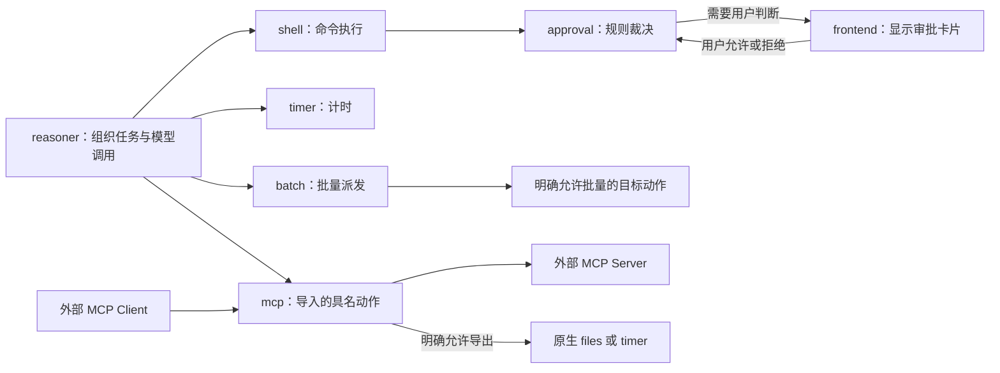
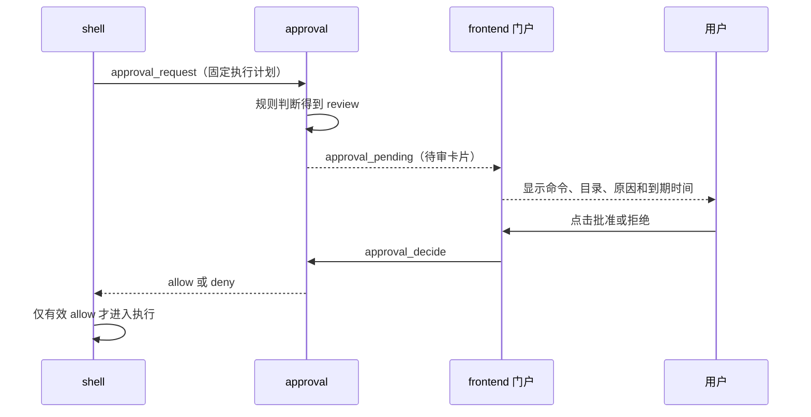

# 05｜执行、审批、计时、批处理与 MCP：事情由谁真正去做

<!-- attribution:start -->
> 由 **xml-nya-meow** 编写与整理，最初用于个人学习与知识积累。如有疏漏、错误或不清楚之处，欢迎指出。
>
> 本页围绕 [SUMP 主项目](https://github.com/NouSart/sump) 编写，为个人学习资料；项目源码与引用内容保留原作者及贡献者归属。
<!-- attribution:end -->

本篇对应源码提交 `6325897cc7fa696610bc25b4c89bc77d6a7c7a43`，整理日期为 2026-10-29。这里解释该快照中的实现，不把后续分支上的修改算作主线功能。

本篇做了源码与测试代码核对，**没有在编写过程中运行产品测试**。下面的过程和数值案例是教学模拟，不是一次真实任务的日志。

## 1. 先把五个角色分开

你让助手“读文件、跑命令，过一会儿再提醒我”，这句话包含几种不同的工作。SUMP 把它们交给不同服务，并没有让一个大程序包办全部细节。

| 模块 | 白话解释 | 主要工作 | 不负责的事 |
|---|---|---|---|
| `shell` | 终端操作员 | 在指定解释器里执行获准命令，收集输出并补报 | 决定用户整体任务该怎么规划 |
| `approval` | 命令审批员 | 看执行计划，给出允许、拒绝或人工审查 | 真正执行命令；审查用户聊天是否合适 |
| `timer` | 独立闹钟 | 记下时间，到点向原调用方补报 | 长期日历、重启后可靠恢复提醒 |
| `batch` | 一批工作的派发与记账员 | 按调用方声明的并发数分发条目，汇总、查询和控制 | 猜测每项业务含义；自动重做有风险的操作 |
| `mcp` | 两种协议之间的翻译员 | 让外部 MCP 工具与 SUMP 显式互通 | 模型路由、全局任务规划、通用执行沙箱 |

**解释器**是把命令文本变成实际操作的程序，例如 PowerShell 或 Bash。**协议**是程序之间约定的数据格式和交互规则。**沙箱**是由运行环境限制程序能碰到什么的隔离机制；“先检查命令文本”不等于已经拥有沙箱。

它们都是独立的 Go 服务，复用 `protocol` 的消息约定和 `service` 的通信骨架。`shell` 通过网络向 `approval` 求裁决，不导入审批服务内部的 Go 实现。



箭头表示业务请求方向。结果通常沿请求返回；耗时工作也会另发 `report_result`，所以不能把这张图理解成“只发不回”。设置中心提供名册和配置，图中的业务请求按名册找到地址后直接连接目标。

## 2. shell：先接单，审批通过后才执行

### 2.1 输入和输出分成两次

模型看到的工具名通常是 `shell__run`。内部动作是 `shell` 服务的 `run`，业务正文主要有两个字段：

```json
{"command":"Get-Location","work_dir":"."}
```

这是一份正文示意，不是可直接发给 WebSocket 的完整信封；命令也要与服务选定的解释器匹配。`work_dir` 是工作目录，省略时使用服务配置的根目录；相对目录由服务解析。

`actionRun` 检查命令、目录和容量。受理后生成 `item_id`，启动后台工作，然后立即返回：

```json
{"item_id":"示意句柄-S1","phase":"queued"}
```

**句柄**就是以后追踪同一件工作的号码。这里的 `queued` 是当前代码实际使用的回执值，**不表示存在先进先出的执行队列**。本版 shell 没有这样的队列；拿到名额就进入审批流程，拿不到就明确拒绝。

后续结果作为新的 `report_result` 发回原调用方，而不是不断往最初的响应里追加字符。正文带 `item_id`、`phase`、`text`、`data`、`final`：

| `phase` | 发生了什么 | `final` | 还要看什么 |
|---|---|---|---|
| `approved` | 审批已通过，准备执行 | `false` | 仍须等执行结果 |
| `rejected` | 未获许可、许可过期或执行描述不符 | `true` | 原因与审批反馈 |
| `failed` | 启动或执行收集过程发生错误 | `true` | `error` 等字段 |
| `done` | 执行结果已收集 | `true` | `exit_code`、`timed_out`、`error`、输出 |

**`done` 不保证业务成功。** 命令退出码非零，甚至执行超时，都可能落在 `done` 这条“结果已收集”的路径。必须继续读 `data`。`stdout` 是正常输出，`stderr` 是错误输出；名字叫错误输出也不代表其中每行都一定是失败。

### 2.2 执行前后具体做什么

一次网络审批路径可以按六步阅读：

1. `actionRun` 校验输入，解析真实目录，预占名额；默认上限为 64。
2. `preparePlan` 固定命令、目录、解释器路径、启动参数、超时、输出上限等，组成 `ExecutionPlan`。
3. `approveJob` 向审批服务发送 `approval_request`，等待有效裁决。
4. `validateBeforeExecution` 再核对计划摘要与许可有效期，防止“审批的是甲，实际执行乙”。
5. `runCommand` 通过 Go 的 `os/exec` 启动子进程，分别收集两路输出。
6. 执行结束后归还名额，再补报结果；结果投递慢不应一直占着执行名额。

名额在审批前就占用，因此 `exec.max_running` 也会约束正在等待审批的受理工作，并非只计算已经启动的系统进程。审批服务内部另有自己的解析并发上限，这是两个不同计数。

Windows 自动探测优先尝试已安装的 Git Bash，再尝试 `bash`、`pwsh`、`powershell`、`cmd`。它不保证每台机器选到同一个解释器，也不要求把 Windows 项目搬到 Linux。需要固定行为时使用 `exec.shell` 指定解释器。

**超时**通过 Go `Context` 传入进程控制：到了期限尝试终止进程树。Windows 使用 `taskkill /T /F`，失败后退回终止直接子进程；其他平台使用进程组。它属于尽力终止，不是“所有后代进程必然消失”的证明。

**输出截断**由 `limitWriter` 实现：只保留有限内容，继续统计实际输出字节数。默认每一路保留 256 KiB。比如命令实际输出 1 MiB，返回值会标注 `truncated`，不能把保留片段当作全部输出。

### 2.3 一个只读命令的教学过程

假设服务显式使用 PowerShell，目录合法，当前策略允许 `Get-Location`：

| 时间顺序 | shell 的状态 | 调用方知道什么 |
|---|---|---|
| ① 收到请求 | 检查并占名额 | 请求还没有证明可执行 |
| ② 返回句柄 | 后台审批中 | 已受理；不能说“执行成功” |
| ③ 得到 `allow` | 核对计划，发 `approved` | 审批允许了这份执行计划 |
| ④ 子进程退出 | 得到退出码和输出 | 结果尚需送达 |
| ⑤ 发 `done` | 工作结束，名额归还 | 根据退出码和正文判断结果 |

若步骤③是 `deny`，流程直接补报 `rejected`，不会启动被审命令。若步骤⑤网络失败，命令仍可能已经执行完成；不能因为“没收到结果”就自动再跑一遍。

源码入口：[actionRun、process 与 report](https://github.com/NouSart/sump/blob/6325897cc7fa696610bc25b4c89bc77d6a7c7a43/shell/server/server.go)、[执行计划与许可核验](https://github.com/NouSart/sump/blob/6325897cc7fa696610bc25b4c89bc77d6a7c7a43/shell/server/remote_approval.go)、[执行与输出限制](https://github.com/NouSart/sump/blob/6325897cc7fa696610bc25b4c89bc77d6a7c7a43/shell/server/exec.go)、[Windows 进程处理](https://github.com/NouSart/sump/blob/6325897cc7fa696610bc25b4c89bc77d6a7c7a43/shell/server/proc_windows.go)。

## 3. approval：判断的是执行计划，不是聊天提示词

### 3.1 第一层如何判断

审批输入不是一句“帮我看看危险不危险”，而是 `schema_version`、`item_id` 和完整 `plan`。输出包括裁决、理由码、计划摘要、规则版本、许可期限和可读说明。

| 名词 | 通俗解释 | 在这里的用途 |
|---|---|---|
| AST，抽象语法树 | 把命令拆成“命令、参数、管道、表达式”等结构 | PowerShell 解析器用它识别静态与动态结构 |
| 词法/结构分析 | 识别文本中的词、引号、分隔符与组合方式 | Bash 路径分析命令段与参数 |
| 策略快照 | 一次审批期间固定不变的规则副本 | 避免同一次判断前半段用旧规则、后半段用新规则 |
| 摘要，Digest | 对约定字段计算出的短指纹 | 把批准结果绑定到同一份执行描述 |
| fail-closed | 无法确认允许时，执行端保持不执行 | 缺审批、超时、响应无效都不当作放行 |

PowerShell 路径启动固定的解析脚本，把待审命令作为标准输入中的数据送进去，不把待审命令直接当解析脚本执行。Bash 路径使用项目内的 Go 分析代码。它们都不是在调用 LLM 猜命令用途。

`Evaluate` 先检查版本、命令文本、方言和运行环境，再进入对应分析器。明确命中禁止项产生 `deny`；符合允许规则产生 `allow`；未覆盖、动态结构或环境不符等产生 `review`。**`review` 是需要进一步判断，不是暂时允许。**

当前服务默认自动批准档位为 `low`。源码还定义 `off`、`medium`、`workspace`。这里要注意实现范围：档位分支在 Bash 分析路径中使用；PowerShell 路径仍按 AST 和策略规则判断，不能把面板上的档位说明机械理解成每种解释器都完全相同。

`medium` 和 `workspace` 比低档宽松。`workspace` 对命令中可识别的工作区路径和操作作判断，但脚本运行时仍可能计算新路径。它不是操作系统沙箱。`exec.root` 校验起始工作目录，也不能单独保证命令里的每个路径访问都被系统拦住。

### 3.2 第二层已经有哪些功能

本快照已经有门户人工裁决，不是“只有预留接口”。当第一层返回 `review`：



待审项保存在 approval 的内存表中，用带一个缓冲位的 Go 通道等待用户选择。**通道**可以理解为程序内部投递一份结果的小信箱。它让这一条审批等待，不会把整个服务的其他审批都冻结。

默认人工等待最多 10 分钟、同时待审最多 32 条。解析与规则判断结束后先归还解析槽位，再进入人工等待。门户缺席、待审容量满或超时，都不会变成批准。只有 `review` 进入这一步；规则明确给出的 `deny` 不会自动变成可在门户翻案的待审项。

用户批准后，shell 收到的许可最多有效 30 秒。许可起算点在 shell 拿到裁决时，不是用户开始阅读卡片时。执行前还要核验。字段 `llm_feedback` 是给模型读的说明，不表示说明一定由 LLM 生成；本版尚未完成“另请 LLM 解读命令”的完整功能。

门户裁决入口按信封 `from` 检查来源服务名。这个检查服务于可信内部网络的路由边界，不能等同于公网身份认证。计划摘要也不证明调用者身份，不冻结磁盘上的脚本内容。

### 3.3 读目录和读代码为什么要一起做

本快照 `capabilities` 的 `dialects` 仍只列 PowerShell，而 `Engine.Evaluate` 已有 `Dialect == "bash"` 的实际分支。非 PowerShell 的执行计划构造代码也留有旧注释。因此判断能力时应继续打开处理函数，不能仅凭说明文字断言“只能审批 PowerShell”或“任何 POSIX shell 名称都自动走 Bash 分析”。

源码入口：[公共审批结构与 ValidateFor](https://github.com/NouSart/sump/blob/6325897cc7fa696610bc25b4c89bc77d6a7c7a43/protocol/approval.go)、[规则引擎](https://github.com/NouSart/sump/blob/6325897cc7fa696610bc25b4c89bc77d6a7c7a43/approval/engine/engine.go)、[Bash 路径](https://github.com/NouSart/sump/blob/6325897cc7fa696610bc25b4c89bc77d6a7c7a43/approval/engine/bash.go)、[档位判断](https://github.com/NouSart/sump/blob/6325897cc7fa696610bc25b4c89bc77d6a7c7a43/approval/engine/tier.go)、[人工裁决](https://github.com/NouSart/sump/blob/6325897cc7fa696610bc25b4c89bc77d6a7c7a43/approval/server/review.go)。

## 4. timer：把“等一会儿”从模型调用里移出去

### 4.1 计时不需要让模型一直忙等

模型可以请求：

```json
{"ms":5000,"note":"检查上一项工作是否需要继续"}
```

这里调用的是 `timer.sleep`，`ms` 是毫秒，5000 毫秒等于 5 秒。timer 建立 `time.Timer` 与内存记录，然后返回 `item_id`、`phase:"queued"` 和 `fire_at`。它没有在请求处理函数里停住 5 秒。

到点后，回调从表里取走记录，向原调用方发送 `phase:"done", final:true` 的补报，附带当初的备注。同一时间可以存在多个独立计时器，长计时不必挡住短计时。

| 动作 | 输入 | 当前实际输出含义 |
|---|---|---|
| `sleep` | `ms`，可选 `note` | 已受理句柄和预计到点时间 |
| `cancel` | 原生 `item_id` | `canceled` 表示从待计时表中撤销；`unknown` 表示当前找不到 |
| `list` | 空正文 | `seq` 与当前计时器清单 |

取消会发送一条 `final:true` 的 `canceled` 补报，让调用方释放在途登记。`unknown` 可能是早已到点、早已撤销或从未存在，当前实现没有留下全部历史来进一步区分。目录文字虽提到 `already_fired`，实际 `actionCancel` 不返回这个值。

### 4.2 门户倒计时与实际执行是两件事

timer 按 `boss` 分组向门户推送 `timer_state` 快照。快照带递增的 `seq`，类似每张清单的版号，门户用它避免旧清单晚到覆盖新清单。

最后一个计时器消失时，还会向原来显示过它的门户分组发空清单。否则页面可能一直显示一个已经结束的倒计时。这个 UI 状态推送不代替发给调用方的业务补报。

默认单次最多 1 小时、同时最多 64 项，设置允许调整，但单次硬上限为 23 小时、下限为 100 毫秒。23 小时上限与调用方异步登记寿命有关：提醒比对方的记账寿命还长，最后可能无人认领。

**计时表不落数据库。** timer 重启会丢失在途计时；它不能直接当作“明天一定提醒”的可靠日程系统。原生 `cancel` 按句柄查找，并没有像 MCP 导出层那样再核验外部主体归属，仍属于可信内部网络接口。

源码入口：[actionSleep、fire、actionCancel 与 pushPortalState](https://github.com/NouSart/sump/blob/6325897cc7fa696610bc25b4c89bc77d6a7c7a43/timer/server/server.go)。

## 5. batch：一批任务的并发与账本

### 5.1 它比“同时发几个请求”多了什么

如果调用方一次声明 100 项工作，自己逐一维护编号、状态、失败汇总和暂停开关会很麻烦。batch 接收整批清单，把这些机械管理留在服务侧。

它使用 Go 的并发工作循环派发请求，用 `modernc.org/sqlite` 驱动访问 SQLite。**SQLite** 是保存在本机文件中的数据库，这里保存批次、条目、策略和结果摘要；不需要另起一台数据库服务器。

`run` 先核对目标，再预留并发槽位和写入账本，随后返回：

```json
{"item_id":"示意批次-B1","total":3,"phase":"accepted","kind":"once"}
```

`kind:"once"` 表示一次性批次。`resident` 是供调用方区分常驻类工作的标签，不会凭这个词自动把有限清单变成永不停止的循环。

动作有五个：`run` 提交，`status` 看计数，`result` 分页看条目摘要，`list` 看批次列表，`control` 做暂停、恢复、取消。完整字段见 [protocol/batch.go](https://github.com/NouSart/sump/blob/6325897cc7fa696610bc25b4c89bc77d6a7c7a43/protocol/batch.go)。

### 5.2 当前有一个必须知道的接入限制

目标动作必须在名册中显式声明 `Batchable:true`，意思是“这个动作允许由 batch 按当前结果契约批量调用”。`Tool:true` 只说明可展示给模型，并不自动授予批量权限。

对本快照的声明核对发现：**正式服务的现有动作没有显式开启 `Batchable:true`；测试夹具中的 `worker.ok/fail/slow` 开启了它。** 因此批处理引擎、账本与控制流程存在，不能据此说默认项目已经能直接批量跑 `files.read`、`shell.run` 或外部 MCP 工具。

MCP 导入动作还明确保持 `Batchable:false`。这是权限和结果生命周期的边界：batch 当前一项通过 `s.Call` 返回就记结果，并没有为任意异步目标再接管后续补报。未经适配就给异步动作打上可批量标志，会混淆“这一项受理了”和“这一项完成了”。

### 5.3 用现有测试夹具理解一次批量业务

下面使用仓库测试专用的 `worker.ok`，不是默认启动器中的生产服务。它接收 `n`，返回 `n` 和两倍数值 `doubled`。

```json
{
  "service":"worker",
  "action":"ok",
  "concurrency":2,
  "wake":{"mode":"key"},
  "items":[
    {"input":{"n":1},"key":true,"tag":"第一项"},
    {"input":{"n":2},"tag":"第二项"},
    {"input":{"n":3},"tag":"第三项"}
  ]
}
```

1. 校验目标声明可批量，预留 2 个全局槽位，把 3 项输入和本批策略写入数据库。
2. 派发第一、第二项；第三项暂留本批自己的待开始列表。
3. 任一项结束后，可以派发第三项。返回先后由实际工作耗时决定，不能假设按编号返回。
4. 第一项是关键项。如果它结束时仍有其他项未结束，可发一次 `progress, final:false` 提示关键部分已结束。
5. 全部结束后更新账本，发 `done, final:true` 汇总；明细中可看到 `2、4、6` 对应的结果摘要。

上面的输出数值由夹具函数决定，时间顺序只是模拟。**关键项结束不等于关键项成功**：关键项也可能以失败结束，调用方还须读失败计数。

batch 区分两种等待：全局名额不够时，本次请求立即 `BATCH_BUSY`，不进入跨批次等待队列；已受理的一批内部，剩余条目可以等自己的并发槽。这使“该等哪些工作”由调用方的清单明确表达。

### 5.4 状态、暂停和重启

| 层级 | 常见状态 | 含义 |
|---|---|---|
| 批次 | `accepted`、`running`、`paused` | 已登记、执行中、暂停继续派发 |
| 批次终态 | `done`、`failed`、`cancelled` | 全部结束、存在失败、已取消 |
| 单项 | `pending`、`running` | 未派发、请求在途 |
| 单项终态 | `ok`、`failed`、`skipped` | 已得结果、失败、未执行而跳过 |

`pause` 停止发出后续条目，已发出的条目继续收尾；待在途工作排空后释放保留槽位。`resume` 重新取得容量后继续剩余项。`cancel` 把未开始项转为 `skipped`，也不会强行终止已发出的目标请求。

`on_error:"stop"` 在首次失败后停止开始新项；默认 `continue` 只记这项失败，其他项继续。这不是数据库事务：前面的成功写入不会因后面的失败自动撤销。

重启时，账本里的未完成批次默认转 `paused`；原来标为 `running` 的条目记成失败并说明“执行结果未知”，不会自动重跑。因为远端可能已经完成，只是返回值没保存下来。启用 `resume_on_start` 可以继续剩余未开始项，但仍不会把结果未知的已派发项当成安全重试对象。

结果明细只存有长度上限的摘要，不是原始完整响应。条目终结后会清除保存的原始输入。需要完整结果时应使用目标服务自身的查询能力；有副作用的动作不能为了“取结果”直接再执行一次。

源码入口：[受理、派发与汇总](https://github.com/NouSart/sump/blob/6325897cc7fa696610bc25b4c89bc77d6a7c7a43/batch/server/run.go)、[暂停与恢复](https://github.com/NouSart/sump/blob/6325897cc7fa696610bc25b4c89bc77d6a7c7a43/batch/server/control.go)、[数据库账本](https://github.com/NouSart/sump/blob/6325897cc7fa696610bc25b4c89bc77d6a7c7a43/batch/store/store.go)、[重启恢复](https://github.com/NouSart/sump/blob/6325897cc7fa696610bc25b4c89bc77d6a7c7a43/batch/server/server.go)、[教学夹具的实际函数](https://github.com/NouSart/sump/blob/6325897cc7fa696610bc25b4c89bc77d6a7c7a43/batch/tests/harness_test.go)。

## 6. MCP：同一服务向内、向外说不同的话

### 6.1 “双向”不是自动开放所有能力

MCP，全称 Model Context Protocol，是应用连接工具与数据的一套约定。SUMP 的 `mcp` 服务一面实现 MCP Server，供外部客户端访问；另一面实现 MCP Client，去调用外部服务器。

| 方向 | 进入 MCP 服务前 | 翻译后 | 谁实际干活 |
|---|---|---|---|
| 导出 | 外部 MCP 工具请求，HTTP/JSON | SUMP `jump`，WebSocket/MessagePack | 被显式绑定的原生服务 |
| 导入 | SUMP 调用 `mcp` 的具名动作 | 外部 MCP `tools/call` | 配置选定的外部服务器 |

**JSON** 是可读的结构化文本；**MessagePack** 是结构化数据的二进制编码。翻译不仅是换一种编码，还要核对工具名、参数类型、授权、结果归属和错误含义。

这个模块使用官方 Go SDK `v1.8.0`，源码锁定协议字符串 `2026-07-28`；输入输出 Schema 校验使用 `jsonschema-go`。这些是本快照的实现基线，并非承诺兼容任意 MCP 客户端版本。

**Schema** 可以理解为一份表格填写规则：哪些字段必填、字段是文字还是数字、能否有额外字段。导入配置把一个内部动作固定绑定到一个外部服务器的一个工具，并固定其 Schema。

配置里的三类清单分别表示：

- `remotes`：哪些外部目标被选中，地址和证书信任如何配置。
- `imports`：其中哪些具体工具可以由 SUMP 调用，内部动作叫什么。
- `exports`：哪些已经实现翻译的原生能力可以对外发布。

发现外部目录里还有 50 个工具，不会让它们自动变成 SUMP 服务。导入一个工具，也不会自动允许外部再经本服务调用它。当前显式导出绑定有 `files__read`、`timer__sleep`、`timer__cancel`；没有通用“给任意服务名就转发”的入口。

### 6.2 同步导出：外部读一个已存在的文件

假设管理员配置 `{"exports":["files__read"]}`，文件已由 files 保存，并已配置入口凭据：

1. 外部应用调用 `files__read`，传 `{"id":"示意文件ID"}`。
2. HTTP 层逐请求核验 Bearer 凭据。Bearer 是“持有即能使用”的访问令牌，不应写进普通工具参数。
3. 翻译层检查字段、当前导出权限，以及名册中的 `files.read` 是否仍符合工具和异步声明。
4. MCP 产生自己的原生调用编号与追踪编号，以 `from=mcp,boss=mcp` 访问 files。
5. files 返回文件名、正文、裁切标志等；MCP 按约定转换为 MCP 文本内容与结构化内容。

没有任一步需要设置中心搬运文件正文。外部客户端也不能通过参数选择原生信封里的 `from`、`to` 或 `boss`。

### 6.3 同步导入：SUMP 使用外部工具

假设配置把 `mcp.lookup` 绑定到远端 `catalog` 的 `lookup`，输入需要字符串 `query`。这里的 lookup 是配置示例，不是 SUMP 自带搜索引擎。

| 顺序 | 工作 | 不符合时 |
|---|---|---|
| ① | 按固定绑定解析输入并校验 Schema | 拒绝，不提交工具 |
| ② | 取得目标专属凭据和容量 | 缺凭据或满额则拒绝 |
| ③ | 连接远端，核对协议版本和工具目录 | 不匹配就停止 |
| ④ | 对照输入、输出 Schema，再检查取消和凭据状态 | 契约变化不擅自适配 |
| ⑤ | 发出一次 `tools/call` | 不自动重放业务操作 |
| ⑥ | 校验返回值，转换成 SUMP 结果 | 区分明确错误和结果未知 |

每次调用拥有独立 SDK 调用连接，目标共用底层 HTTP 连接池。**连接池**是复用已经建立的网络连接以减少重复建立连接的工作；它不意味着几个调用可以混用结果。

网络请求成功收到远端业务错误时，SUMP 的 `response.ok` 可以为 `true`，正文却是 `is_error:true`、`phase:"failed"`。前者表示这次适配请求拿到了可表达的结果，后者才是工具业务结果。

调用已经发出却没有拿到确认时，使用 `MCP_OUTCOME_UNKNOWN` 等结果未知说明。它不等于“命令没执行”。模块不会为这种情况偷偷重试。

### 6.4 异步导入和异步导出不是同一种等待方式

**异步导入：** 配置 `async:true` 的具名动作先给 SUMP 调用方一个 `accepted` 回执，后台执行外部请求，最后用原生 `report_result` 补报。结果阶段为 `completed`、`failed` 或 `outcome_unknown`。

后台工作跟随服务的生命周期和观察期限，不跟随“已经返回回执的那次请求”结束。否则回执一返回，后台请求就可能被误取消。这是 `Context` 使用上的关键区别：它携带某一段工作的取消和超时信号，而不是整个项目共用的总开关。

调用原生 `cancel_import` 只取消本地等待；`observation_cancelled` 不证明远端停止，输出仍明确 `remote_outcome:"unknown"`。

**异步导出：** 外部调用 `timer__sleep` 后，收到 `job_id` 和 `resource_uri`，以后通过标准 `resources/read` 读取 `sump://jobs/<job_id>`。它是临时结果观察资源，不是新建了一套全局任务调度器。

| 观察 `state` | 白话含义 | 是否能说原生工作已结束 |
|---|---|---|
| `reserved` | 记录已预留，准备关联 | 不能 |
| `accepted` | 已关联原生受理回执 | 不能 |
| `unknown` | 暂时不能确认结果 | 不能 |
| `final` | 已收到可确认的终态 | 还要读具体 `phase`，如 done 或 canceled |

MCP 在发出原生请求前预留记录，所以能处理“补报比受理回执先到”。关联会核对来源服务、专用 `trace` 和 `item_id`。外部用 `job_id`，内部用 `item_id`，不是同一个号码。

导出计时最多允许 600000 毫秒，即 10 分钟，这是 MCP 绑定的限制，比原生 timer 的可配上限窄。取消需用当前主体自己的 `job_id`，MCP 再换成原生句柄；不能拿别人提供的任意 `item_id` 就取消。

观察记录只在内存里。默认观察等待 2 分钟后可变为 `unknown`，记录从创建起 15 分钟后过期；过期清理不等于取消原生计时。早到、晚到、重复终态与重启分别有不同处理路径。

### 6.5 这版实现的边界

本模块没有新增数据库或临时验收前端，复用已有设置面板。入口秘密与每个远端秘密分开保存，普通配置文件不放令牌。服务设置的保存、回调与运行时凭据生效是不同步骤；仅有鉴权检查不代表所有配置故障都能自动、完整地回滚。

`exports` 可以按有效配置热更新；`imports` 和 `remotes` 是启动时固定声明，改动需要重启。热更新是“进程不重启就换配置”，不表示所有配置都可热改。

远程入口要求显式启用、HTTPS 证书和已有凭据。HTTPS 对传输加密并验证服务端身份，但本版仍是单主人预配置 Bearer，不提供完整多用户授权、OAuth、MCP Tasks、stdio 接入或远程 shell 导出。内部 WebSocket 仍属于可信网络，不能因此直接公开。

模块将远端返回内容作为工具数据传递，不提升成系统指令；这是一条职责边界，**不能单凭协议翻译就声称已经解决提示词注入**。真正如何使用外部内容，还涉及模型上下文、工具权限和执行端控制。

源码入口：[HTTP 入口](https://github.com/NouSart/sump/blob/6325897cc7fa696610bc25b4c89bc77d6a7c7a43/mcp/server/http.go)、[显式字段翻译](https://github.com/NouSart/sump/blob/6325897cc7fa696610bc25b4c89bc77d6a7c7a43/mcp/server/bindings.go)、[导入调用与契约检查](https://github.com/NouSart/sump/blob/6325897cc7fa696610bc25b4c89bc77d6a7c7a43/mcp/server/imports.go)、[异步导入](https://github.com/NouSart/sump/blob/6325897cc7fa696610bc25b4c89bc77d6a7c7a43/mcp/server/async_imports.go)、[异步导出](https://github.com/NouSart/sump/blob/6325897cc7fa696610bc25b4c89bc77d6a7c7a43/mcp/server/async_exports.go)、[观察状态机](https://github.com/NouSart/sump/blob/6325897cc7fa696610bc25b4c89bc77d6a7c7a43/mcp/server/jobs.go)。

## 7. 五种“结束”放在一起比较

| 看见的现象 | 真正能得出的结论 | 不能直接得出的结论 |
|---|---|---|
| shell 返回 `queued` | 接受了本次工作 | 命令已经执行成功 |
| approval 返回 `allow` | 本计划取得短期许可 | 对应命令一定安全、必然成功 |
| timer 的回执返回 | 已建立计时 | 到点补报一定送达、重启后仍会提醒 |
| batch 暂停 | 不再开始后续条目 | 所有目标服务已经停止 |
| MCP 观察超时 | 本地没有确认结果 | 外部没有执行，可以随便重发 |
| `final:true` | 发送方结束了这段报告/观察生命周期 | 每种业务都成功，所有远端副作用都已停止 |

这些区别使模块可以分别维护自己的状态。Reasoner 决定如何继续用户任务；执行服务报告事实；门户展示状态；某一层不能只凭自己不再等待，就替另一层宣布“全部已停止”。

## 8. 不运行程序也能先做的阅读练习

1. 打开 shell 的 `actionRun`，找出创建 `item_id`、启动后台函数和返回回执的三行。解释它们为什么不等于成功执行。
2. 打开 `runCommand`，找到 `TimedOut` 与 `ExitCode` 的赋值。说明为什么只看 `phase` 会误判。
3. 打开审批 `awaitUserDecision`，分别追踪门户离线、用户拒绝、等待超时三条路径。
4. 打开 timer 的 `actionCancel`，核对它实际返回哪些状态，再看门户如何收到空快照。
5. 打开 batch 的 `runItem`，观察它以哪一次返回判定条目结束。再解释为何不能随意批量包装一个异步动作。
6. 打开 MCP 的 `callAsyncTool`，确认预留观察发生在网络调用之前；解释早到补报如何找到自己的位置。

想进一步复现时，可在固定源码的对应模块目录运行已有测试。下面列的是源码中存在的测试名称，**不是本篇新增的通过记录**：

| 模块 | 可定位的测试 | 学习目标 |
|---|---|---|
| shell | `TestExecutionRequiresUnchangedUnexpiredApproval` | 获准内容与执行内容必须一致且未过期 |
| approval | `TestReviewDoesNotBlockOtherApprovals` | 一条等用户，不等于整个服务停工 |
| timer | `TestLongTimerDoesNotBlockOthers` | 长短计时独立推进 |
| batch | `TestPauseResumesWithoutRerun`、`TestRestartTurnsRunningIntoPaused` | 暂停恢复与结果未知的处理 |
| MCP | `TestExportEarlyFinalAndCrossRequestRead` | 早到结果与跨 HTTP 请求读取 |
| MCP | `TestAsyncImportsCancellationIsOwnerScopedAndNotRemoteStop` | 取消本地观察与停止远端执行的区别 |

例如在 `timer` 模块目录使用 `go test ./tests -run '^TestLongTimerDoesNotBlockOthers$' -count=1`。测试进程会使用仓库自己的夹具；先按基础课程准备 Go 环境，不需要为本篇公开任何服务端口。

课程导航：[本组课程入口](README.md) · [完整请求流程](06-一次请求的完整旅程.md) · [术语词典](08-术语状态与学习地图.md)。

<!-- attribution-footer:start -->
---

**编写与整理：xml-nya-meow** · 原用途：个人向知识库。

如有不足，欢迎提出勘误或改进建议：[反馈入口](https://github.com/xml-nya-meow/sump-knowledgebase/issues)。

[个人知识库](https://github.com/xml-nya-meow/sump-knowledgebase) · [SUMP 主项目](https://github.com/NouSart/sump)

阅读时请核对本页对应的源码版本；本文不代表 SUMP 官方文档。转载或同步时请保留编写者、来源和适用的许可说明。

内容责任与立场说明：若知识库内容存在问题，由对应编者负责核查与修订；本页内容不代表其他团队成员、组织成员或组织的意见与观点。
<!-- attribution-footer:end -->
