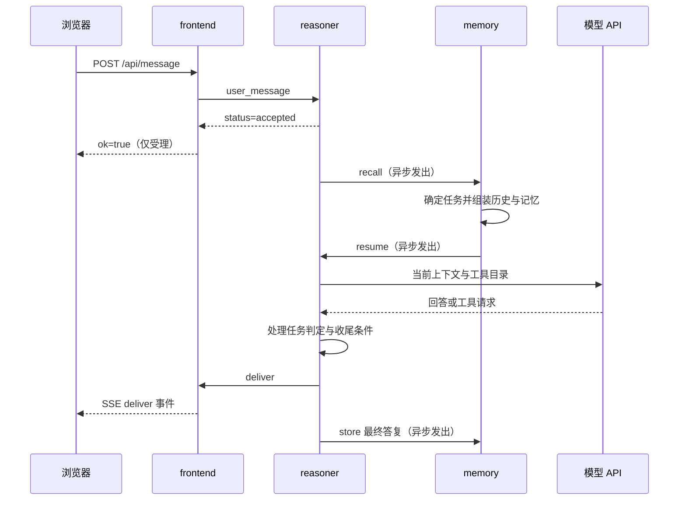

# 06｜一次请求的完整旅程：输入、中间态、并行工作与最终交付

<!-- attribution:start -->
> 由 **xml-nya-meow** 编写与整理，最初用于个人学习与知识积累。如有疏漏、错误或不清楚之处，欢迎指出。
>
> 本页围绕 [SUMP 主项目](https://github.com/NouSart/sump) 编写，为个人学习资料；项目源码与引用内容保留原作者及贡献者归属。
<!-- attribution:end -->

本篇对应主线提交 `6325897cc7fa696610bc25b4c89bc77d6a7c7a43`。为了看清程序行为，下面使用教学模拟编号和文字；它们不是从用户日志中摘录的真实记录。

本次核对了源码与已有测试，没有运行服务、调用模型或执行测试。模型实际选择什么工具、说什么话，会受模型、提示词、服务目录和历史影响。

## 1. 先把“一个请求”拆成几种尺度

你只按了一次发送键，系统可能产生许多次网络请求。

| 尺度 | 例子 | 何时算这一层结束 |
|---|---|---|
| 浏览器的一次 HTTP 请求 | 把“你好”发到 `/api/message` | 收到 HTTP 响应 |
| 一次 SUMP 调用 | frontend 调 reasoner 的 `user_message` | 收到匹配该请求的协议响应 |
| 一轮模型生成 | 根据当前上下文决定回答还是调工具 | 模型接口返回这一轮结果 |
| 一项工具工作 | timer 计时、shell 执行命令 | 取决于该工具的同步结果或异步终态 |
| 一次黑板工作窗口 | reasoner 暂存上下文，连续推进若干轮 | 已交付并关闭，或被新上下文取代 |
| 一份任务档案 | “整理资料”的持久记录 | memory 接受完成判定并更新档案 |

所以“请求成功”必须补上宾语：是提交消息成功、工具执行成功，还是最终答复送达成功？

## 2. 场景一：在网页里发一句普通问题

模拟输入：

> 请用一句话解释 SUMP 是什么。

假设本轮模型直接给出答案，不需要外部工具；所有必要服务已经启动，模型配置有效。

### 2.1 全程路线图



这张图只表达主要依赖顺序。异步发送的实际到达顺序可能交错，例如 memory 已收到 `recall` 时，浏览器可能还没拿到 HTTP 受理响应。

设置中心没有画在每条业务箭头中，是因为服务已经从名册得到了目标地址，不需要让中心代转每句话。

### 2.2 从按钮到受理：这一段到底完成了什么

浏览器发送的正文示意：

```json
{"text":"请用一句话解释 SUMP 是什么。"}
```

frontend 检查文字非空，补上本版本固定的会话编号，再调用 reasoner。

以下仅展开动作和正文，省略完整信封与二进制编码：

```json
{
  "action": "user_message",
  "input": {
    "text": "请用一句话解释 SUMP 是什么。",
    "conversation_id": "web:private:owner"
  }
}
```

frontend 的 `jumpTo` 把当前服务名放入 `boss`。在这一跳，它表示后续答复应回到哪个交付服务。

reasoner 的 `actionUserMessage` 做这些事：

1. 解码并检查输入。
2. 尝试向 memory 记录用户消息。
3. 清除该会话的停手状态，整理必要附注。
4. 记住入口服务，准备交付失败时的通知路径。
5. 发起记忆往返。
6. 返回 `{"status":"accepted"}`。

此时没有最终回答，也没有证明模型已经调用成功。

### 2.3 记忆往返：让同一句话带上背景

reasoner 不直接把新文字当作全部上下文。它向 memory 发送 `recall`，正文里包含 `context`。

**上下文**是模型这一轮可以看到的材料，例如系统要求、当前消息、历史与记忆。它不是模型永久记住的全部世界知识。

memory 的处理可以拆成：

| 步骤 | 读写什么 | 为什么要做 |
|---|---|---|
| `EnsureTask` | 当前会话的任务档案 | 找到正在继续的任务；没有则创建 |
| `Recent` | 这个任务已有历史 | 知道之前聊到哪里 |
| `TrimOverlap` | 历史尾部与当前消息 | 避免同一段对话重复注入 |
| 组装核心与相关记忆 | 长期条目、可选向量召回 | 补充偏好和相关背景 |
| 加入经验线索 | 经验网召回 | 提供可能有帮助的既往经验 |
| `resume` | 回发整理后的上下文 | 让 reasoner 开始这一轮工作 |

这里的 `boss` 有两层：这次记忆请求由 reasoner 发起；原用户任务的交付方则随 `context.boss` 保存。memory 回来时，reasoner 从上下文恢复原交付目标。

这体现“只处理自己收到的请求”的边界。memory 帮 reasoner 组装材料，不会擅自向浏览器交付最终答案。

### 2.4 模型轮次：可能需要不止一次生成

reasoner 收到合法的 `resume` 后，通过 `boardOpen` 建立当前黑板，`boardKick` 尝试启动模型轮次。

黑板包含当前会话、原交付方、任务编号、消息链以及还没返回的工具。

模型返回后有三种主要分支：

| 模型本轮返回 | reasoner 怎么处理 |
|---|---|
| 一个或多个工具请求 | 派发工具，并记录对应编号 |
| 非空回答文字 | 检查是否允许收尾 |
| 没工具也没文字 | 记录空返回，本轮不产生有效交付 |

即使问题简单，也可能再多一轮，因为任务有完成判定要求。

模型通过内置 `task_status` 给出 `done` 或 `continue`。如果它准备交付却一直不判定，代码最多提醒两次；仍不判定，则按未完成处理并允许交付，避免无限空转。

“回答了一个问题”和“持久任务被标成完成”是两个维度。不能把两者合并成一个布尔值。

### 2.5 收尾：结果怎样回到网页

`tryClose` 先检查普通工具是否仍待返回，以及模型所看的上下文是否过期。

条件允许时，reasoner 调用 `boss` 的 `deliver`，正文含答复、会话编号和任务编号。

frontend 收到后：

1. 检查 `text` 非空。
2. 发布到自己的 DeliverHub。
3. 对 SUMP 调用返回回执。
4. 已订阅的浏览器通过 SSE 收到 `deliver` 事件并显示文字。

**Hub** 在这里是进程内的订阅分发器，可以理解成一个小型通知列表；不是设置中心，也不是持久消息系统。

reasoner 在交付调用成功后尝试存下最终答复，关闭黑板，并按配置在后台复盘。

有一个实际边界：frontend 确认接收并发布到 Hub，不证明人已经读到内容。如果浏览器当时断线，不能把该回执说成“用户已阅”。

### 2.6 这一段最终留下什么

| 位置 | 正常路径中的结果 | 持久性 |
|---|---|---|
| 浏览器 | 答复与过程时间线 | 刷新后需要历史回填 |
| frontend | 临时订阅和展示状态 | 不是会话历史数据库 |
| reasoner | 已交付的黑板被关闭 | 黑板本来就在内存中 |
| memory | 已成功写入的用户消息、任务档案、答复等 | 由 memory 持久保存 |
| 经验记录 | 可能新增少量复盘经验，也可能没有 | 取决于复盘结果及实际写入 |

“正常路径中应发生”不等于“任何网络故障下都保证发生”。记录与复盘不是跨服务强一致事务。

## 3. 场景二：30 秒后提醒我，同时解释一个词

模拟输入：

> 30 秒后提醒我喝水，现在先解释一下什么是 WebSocket。

假设模型选择 `timer__sleep`，参数为：

```json
{"ms":30000,"note":"提醒我喝水"}
```

**毫秒**是千分之一秒；30000 毫秒就是 30 秒。

### 3.1 这里有两张不同的“收据”

第一张是 reasoner 为模型工具调用位置写入的即时受理文字。它表示“这项调用已经登记、将被派发”，还没证明 timer 接受成功。

第二张是 timer 真正返回的业务回执。例如：

```json
{
  "item_id": "timer-example-A",
  "phase": "queued",
  "fire_at": "2026-10-29T12:00:30Z"
}
```

编号和时间仅为示意。源码中 timer 的受理阶段字符串确实是 `queued`。

但这个名字不要理解成“必须排在前一个计时器后面才开始”。timer 为每项工作创建自己的计时器，在容量允许时分别计时；容量满则拒绝，不排队等待空位。

### 3.2 reasoner 为什么还能继续回答

timer 的动作声明 `Async:true`。

**异步受理**表示这次网络响应只交给你一个工作句柄，最终结果随后再送。

reasoner 在发请求前先预留登记；收到有效 `item_id` 后，把它与原服务、追踪编号、任务、工具调用编号关联起来。

普通调用等待位释放，但异步登记还在。所以：

```text
timer 在后台计时
        │
        ├── reasoner 可以继续解释 WebSocket
        │
        └── 30 秒到点后，timer 再发最终补报
```

这就是一个具体的“不阻塞”落点：等待提醒时间流逝，不必占住最初 HTTP 请求或阻止其他独立工具继续工作。

内置 `wait` 也不会一直等这种异步终态。它等待普通待返回调用，并额外说明还有哪些异步工作尚未回报。

### 3.3 到点后收到什么

timer 到点时从自己的待计时表移除该项，然后发送 `report_result`：

```json
{
  "item_id": "timer-example-A",
  "phase": "done",
  "text": "到点了：30s 的计时结束。\n你当时留的备注：提醒我喝水",
  "final": true
}
```

上面保留关键字段；真实提示文字还可能附带其他固定说明。

- `phase` 是工作阶段，由工具定义。
- `final:true` 表示这项补报是终态。
- `item_id` 指向之前那张业务收据。
- 信封中的来源与 `trace` 也参与匹配，不只看编号字符串。

最终补报不是原请求的普通响应。它是一条由 timer 主动发回 reasoner 的新请求。

### 3.4 补报回来时，原来的回答可能早结束了

reasoner 的处理按当前状态分流：

| 补报到达时 | 当前处理 |
|---|---|
| 原黑板仍在工作，归属一致 | 注入原上下文，尝试唤醒下一轮 |
| 当前没有黑板 | 建立沿用原归属的补报轮，请模型做简短补充 |
| 同一会话已被其他工作占用 | 保留原任务编号直接交付补报，不把旧内容塞进新任务 |
| 来源、追踪、句柄不匹配 | 忽略，或在有限的待回执条件下缓存早到回报 |
| 同一工作终态重复到达 | 有界去重机制避免再次处理 |
| 登记已过期或重启丢失 | 不凭空认领，不制造“成功完成”的结论 |

源码中的补报处理返回值可能使用 `new_task` 这样的字符串，但它表示新建补报用的内存工作窗口，不等于创建了一个新的 memory 持久任务档案。

### 3.5 界面倒计时是另一条展示支路

timer 可以向配置的门户发送 `timer_state` 快照。

**快照**是某个时刻的完整列表，不是“加一项、删一项”的历史事件串。

门户记录序号 `seq`，只接受更新的快照，以免晚到的旧列表覆盖新列表。浏览器据 `fire_at` 画出剩余时间。

因此有两条不同的信息链：

```text
执行结果：timer → report_result → reasoner → deliver → 用户
展示状态：timer → timer_state → frontend → SSE → 倒计时界面
```

看到倒计时归零，不足以证明最终提醒已经送达。展示时间与实际交付结果要分别确认。

## 4. 两项工具同时运行：不要按返回顺序猜归属

假设模型同一轮提出两项彼此独立的读取工作：

```text
call-A：files__read，读取文件 A
call-B：files__read，读取文件 B
```

reasoner 为两项工作登记不同的工具调用编号，再在后台分别发请求。B 先返回完全正常。

| 时刻 | pending 普通待返回表 | 黑板看到什么 |
|---|---|---|
| 刚登记 | A、B | 两项调用已派发的记录 |
| B 返回 | A | B 的结果明确标记为 B |
| 模型试图收尾 | A | 收尾被拦，不能假装 A 已回来 |
| A 返回 | 空 | A、B 的结果都已入账 |
| 后续模型轮次 | 空 | 基于已看到的最新材料继续 |

`tool.notify_mode=each` 倾向于每项结果到达就唤醒；`batch` 则把仍有普通工作在途时的唤醒攒到最后一项。这是 reasoner 的通知设置，不是 `batch` 独立批处理服务。

两个名字都叫 batch，职责并不相同。

工具并发还受 reasoner 的会话额度和目标服务自身容量限制。并发是“允许独立工作重叠”，不是无上限，也不保证每次都更快。

## 5. 按异常发生位置判断“卡在哪里”

| 观察到的情况 | 可以说明什么 | 不能直接说明什么 |
|---|---|---|
| 提交接口返回错误 | 前端校验、发现或调用阶段失败 | 不能一概断言所有远端动作从未发生 |
| HTTP 已受理，长期没有回答 | 入口受理成功，但后续链可能停在记忆、模型或交付处 | 不能说模型一定在持续思考 |
| 模型未配置或模型调用失败 | 本版本记录错误，黑板本轮停住，等待后续事件 | 不保证网页立即得到完整错误通知 |
| 工具请求超时 | 在约定时间内没拿到确定响应 | 不等于远端一定没有执行 |
| 用户按下某项暂停控制 | 对应控制状态被提出或应用 | 不等于所有服务的进程都已终止 |
| 历史里没有某条进展 | 没有取到那条持久记录 | 不等于相关动作绝对没发生 |
| timer 进程重启 | 内存计时丢失 | 不会凭原 item_id 自动恢复计时 |
| reasoner 进程重启 | 黑板与异步登记丢失 | memory 中有历史不等于能恢复全部在途工作 |

尤其要记住：**网络超时是一种“不知道结果”的情况，可能不同于明确失败。** 对具有副作用的工具，不应因为没拿到回执就无条件重试。

**副作用**是会改变外部状态的动作，例如写文件、执行命令、发送消息。重复做两次可能造成真实差异。

## 6. “结果不串线”具体靠什么

本版本 reasoner 的异步匹配键是：

```text
source + trace + item_id
来源服务 + 追踪编号 + 工作句柄
```

登记中还保留会话、任务、原始黑板与交付方，以判断回报应回到哪里。

为什么不只用 `item_id`？

不同服务可能恰好给出相同文本编号；旧任务的回报也可能晚到。只按“哪个请求最后发出去”猜归属，会把不相关结果送到一起。

为什么要在派发前预登记？

因为非常快的服务可能先发出最终补报，网络受理响应反而后到。预登记和有界早到缓存可以覆盖这种顺序。

为什么要限制缓存？

不能让任何未知消息无限积累。本版本对待登记数量、单条回报大小、早到缓存容量和存活时间都有边界。

这些关联机制并不等于给原生信封加了身份签名。来源名字仍须在可信的内部服务网络中使用。

## 7. 如何用源码核对这张流程图

不熟悉代码时，按下面顺序每次只找一个函数，不要从所有文件第一行一起读起。

| 想确认的问题 | 源码位置和函数 |
|---|---|
| 网页发出的消息到底交给谁 | frontend `api.ts` 的 `sendUserMessage`；`center.ts` 的 `jumpTo` |
| 受理后怎样请求记忆 | reasoner `infer.go` 的 `actionUserMessage`、`startMemoryRound` |
| memory 怎样送回上下文 | memory `server.go` 的 `actionRecall`、`fireResume` |
| 模型何时调用、何时允许交付 | reasoner `board.go` 的 `boardRound`、`tryClose` |
| 计时器先回什么、后报什么 | timer `server.go` 的 `actionSleep`、`fire`、`report` |
| 晚到补报怎样找原任务 | reasoner `async.go` 的 `finishAsync`、`deliverFollowUp` |

固定版本源码入口：

- [frontend/api.ts](https://github.com/NouSart/sump/blob/6325897cc7fa696610bc25b4c89bc77d6a7c7a43/frontend/src/server/api.ts)
- [reasoner/infer.go](https://github.com/NouSart/sump/blob/6325897cc7fa696610bc25b4c89bc77d6a7c7a43/reasoner/server/infer.go)
- [memory/server.go](https://github.com/NouSart/sump/blob/6325897cc7fa696610bc25b4c89bc77d6a7c7a43/memory/server/server.go)
- [reasoner/board.go](https://github.com/NouSart/sump/blob/6325897cc7fa696610bc25b4c89bc77d6a7c7a43/reasoner/server/board.go)
- [timer/server.go](https://github.com/NouSart/sump/blob/6325897cc7fa696610bc25b4c89bc77d6a7c7a43/timer/server/server.go)
- [reasoner/async.go](https://github.com/NouSart/sump/blob/6325897cc7fa696610bc25b4c89bc77d6a7c7a43/reasoner/server/async.go)

已有测试提供了可阅读的场景：

- [TestInferChain、TestResumeRejected](https://github.com/NouSart/sump/blob/6325897cc7fa696610bc25b4c89bc77d6a7c7a43/reasoner/tests/chain_test.go)：普通工具链和 resume 来源限制。
- [TestAsyncRefuseCloseThenDeliver、TestNotifyModeBatch](https://github.com/NouSart/sump/blob/6325897cc7fa696610bc25b4c89bc77d6a7c7a43/reasoner/tests/async_test.go)：结果未齐时不提前交付。
- [TestReportResultOpensSupplementAfterClose、TestWaitDisclosesOutstandingAsync](https://github.com/NouSart/sump/blob/6325897cc7fa696610bc25b4c89bc77d6a7c7a43/reasoner/tests/async_report_test.go)：收尾后的补报和 wait 的边界。
- [TestAsyncOldTaskDoesNotInjectIntoReplacement、TestAsyncTTLAndRestartDoNotInventResults](https://github.com/NouSart/sump/blob/6325897cc7fa696610bc25b4c89bc77d6a7c7a43/reasoner/server/async_test.go)：旧任务隔离、过期与重启语义。

## 8. 三道自查题

**题一：** 网页显示提交成功，可否据此说模型已经回答成功？

不可以。这证明入口请求被受理；还要观察后续模型、交付与 SSE 链路。

**题二：** timer 回了 `queued`，可否据此说喝水提醒已完成？

不可以。这是计时已受理。最终补报应有对应句柄、阶段和 `final:true`；用户是否看到又是交付层问题。

**题三：** 旧任务的结果晚到了，为什么不能直接接到当前对话的最新任务里？

因为“同一个对话窗口”不等于“同一件工作”。必须保留原任务归属，否则可能让新任务引用无关结果，甚至重复执行错误动作。

课程导航：[本组课程入口](README.md) · [完整请求流程](06-一次请求的完整旅程.md) · [术语词典](08-术语状态与学习地图.md)。

<!-- attribution-footer:start -->
---

**编写与整理：xml-nya-meow** · 原用途：个人向知识库。

如有不足，欢迎提出勘误或改进建议：[反馈入口](https://github.com/xml-nya-meow/sump-knowledgebase/issues)。

[个人知识库](https://github.com/xml-nya-meow/sump-knowledgebase) · [SUMP 主项目](https://github.com/NouSart/sump)

阅读时请核对本页对应的源码版本；本文不代表 SUMP 官方文档。转载或同步时请保留编写者、来源和适用的许可说明。

内容责任与立场说明：若知识库内容存在问题，由对应编者负责核查与修订；本页内容不代表其他团队成员、组织成员或组织的意见与观点。
<!-- attribution-footer:end -->
